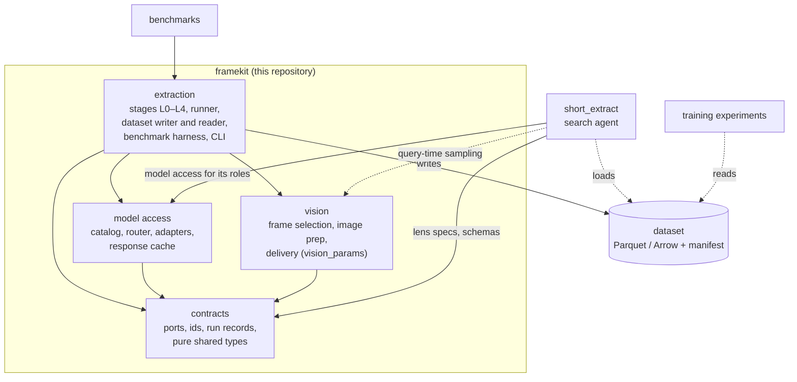
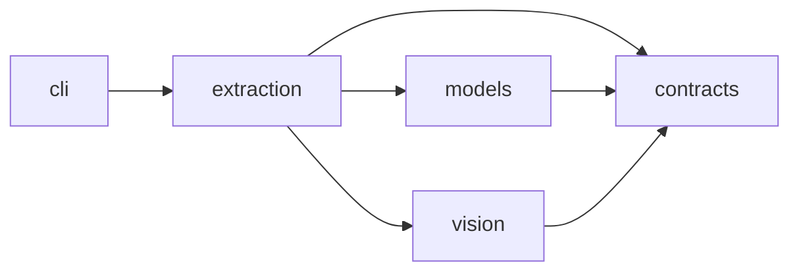
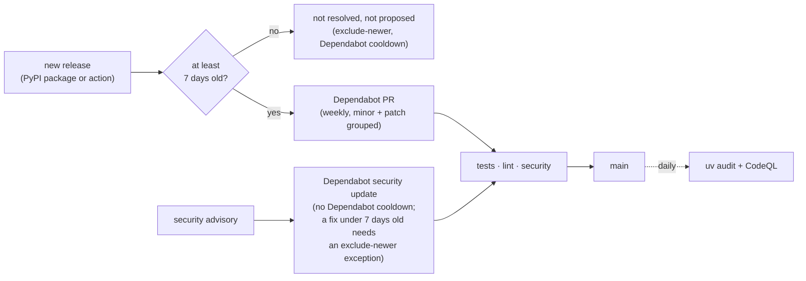
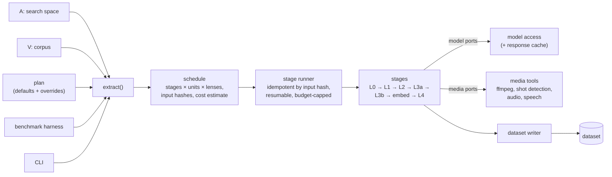
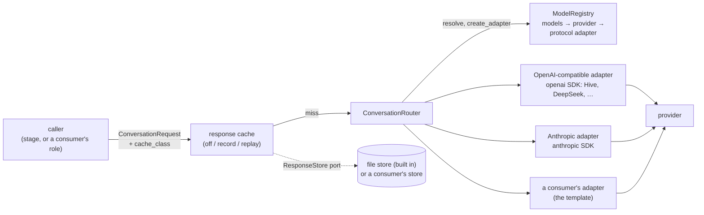

# Architecture: Layers, Packages and Consumers

How framekit's code is organized and how other projects connect to it. Written for collaborators who need the map before writing code. The functional design (what `extract(A, V)` does, stage by stage) is in [DESIGN.md](DESIGN.md); decisions are dated in [DECISIONS.md](DECISIONS.md).

> **Status:** target architecture, approved by the owner on 2026-10-23. **Built (v0.1.0): `contracts` and `models`**, seeded from short_extract (§7). **Partly built on `main` (2026-10-24): `vision`**: the `vision_params` schema, its checks, resolution and pixel-free frame planning; **and `extraction`**: the schemas so far (`framekit.extraction.schemas`: lens specs, search space, corpus, plan, gold set). The rest of `extraction` and the CLI are designed, not built.

---

## 1. Position: one general library, several consumers

framekit is a **general library**, not a single-purpose engine: its modules are useful on their own (a project may use only `framekit.models` for LLM access, or only the dataset reader). Extraction is the first large module; others are added beside it.



| Layer | Owns | Must not |
|---|---|---|
| **contracts** | ports (`conversation`; later `video_understand`, `vision_generate`, `embed_*`), media ports, the `ResponseStore` port, ids, run records, and the pure shared types they use. Not the Pydantic schemas (A, V, plan, dataset manifest, lens spec): contracts stays free of Pydantic, and the plan embeds `VisionParams` from `vision`, so they live in `framekit.extraction.schemas` (decided 2026-10-24) | import anything else in the library, Pydantic, any provider SDK, or any I/O library |
| **model access** | model catalog and registry, router, our own adapters on the official provider SDKs and the template for consumers' own, the response cache wrapper and its file store | know stages, datasets or lenses |
| **vision** | the `vision_params` schema (`VisionParams`, Pydantic, so it can't live in the pure `contracts`) and its checks; the strategy registry and frame selection strategies (candidates, anchors, filters, budget allocation); resolution and digests; frame planning; later image preparation and delivery (DESIGN.md §2.3) | call a model or import `models`; know stages, lenses or corpora |
| **extraction** | stages L0–L4 + embed, the stage runner, the dataset writer and reader, the benchmark harness, the CLI | call a provider SDK directly; contain lens or corpus vocabulary |

**What the library never knows:** any consumer. No sessions, no web framework, no Postgres, no task queue, no consumer's services. A consumer depends on the library; never the other way round.

---

## 2. Packaging and packages

framekit follows the **Python library convention** (decided 2026-10-23): it's installed by other projects (the search app, training experiments, benchmarks), so it's packaged like any library they'd install, not like a deployed app.

| Aspect | Convention |
|---|---|
| Metadata | one `pyproject.toml` (PEP 621): name, version, dependencies, extras, the `framekit` script entry point |
| Build backend | `hatchling` (uv's default); builds a **wheel** and an **sdist** |
| Layout | **src layout**: the code lives in `src/framekit/`, so tests run against the installed package, never against stray files at the repo root |
| Dependencies | **loose ranges** (e.g. `pydantic>=2.6,<3`), so framekit fits into consumers' environments (a training project brings its own PyTorch, NumPy, …) |
| Heavy dependencies | **optional extras**, so consumers install only what they use |
| Lockfile | `uv.lock` is committed for framekit's own development and CI, resolved with a 7-day release cooldown (§2.2); consumers never use it, they resolve their own |
| Typing | ships `py.typed`, so consumers' type checkers see framekit's types |
| Versions | semantic versioning, git tags `vX.Y.Z`; the dataset schema version is separate and recorded in each manifest (§3) |
| Distribution | installed from the git repository at a tag (public repo); publishing wheels to a package index is a later option |

```
pyproject.toml
uv.lock
src/
  framekit/
    __init__.py    public API: extract, Dataset, schemas
    py.typed
    contracts/     ports, ids, clock, run records, ResponseStore (pure: no Pydantic; the Pydantic
                   A / V / plan / dataset / lens spec schemas go above vision and models, §8)
    models/        catalog, registry, router, adapters (base = the template, openai_compatible, anthropic), cache/ (wrapper + file store)
    vision/        params (VisionParams schema + load-time checks), registry, builtin (v1 strategies),
                   resolve (canonical form, digests), checks (source, model), signals (L1 signals
                   for planning), planning (pixel-free); later: pixel filters, image prep, delivery
                   (with the media stage)
    extraction/    stages/ (normalize, signals, segment, perceive, lens_pass, embed, qc),
                   runner/, dataset/ (writer, reader, manifest), bench/, alignment/
    cli.py         `framekit extract …`, `framekit bench …`, `framekit cache stats|wipe`
tests/
docs/
```

| Install | Adds | Typical consumer |
|---|---|---|
| `framekit` | contracts, model access (official SDKs), the schemas and spec files (PyYAML), the dataset reader | anything reading datasets: training experiments, the search app's loader |
| `[media]` | ffmpeg bindings, scene detection, audio, image hashing | running extraction; `framekit.vision`'s pixel work (its schema, checks and planning need no extra) |
| `[speech]` | Whisper + VAD | the `speech` perception module |

**Modules, not packages.** A new capability (say, a training-data helper or a new kind of processing) is added as a new subpackage under `src/framekit/`, with its own import contract and, if it brings heavy dependencies, its own extra. It becomes a separate package only when a consumer needs it without the rest *and* the extras can't provide that (e.g. conflicting dependency ranges).

**Training experiments** read datasets as plain Parquet / Arrow, so they can use whatever training stack they choose (Hugging Face `datasets`, PyTorch, Polars, …). framekit never depends on a training framework; any training helpers would be a separate optional extra, decided when an experiment needs one.

### 2.1 Dependency rules (import-linter)



| Contract | Rule |
|---|---|
| Layers | `cli` → `extraction` → `models` or `vision` → `contracts`; `models` and `vision` don't import each other (enforced: `framekit.extraction` above `framekit.vision \| framekit.models`, independent siblings, above `framekit.contracts`; `cli` joins when it's built) |
| pyarrow, PyYAML | only in `extraction` (enforced: never in `contracts`, `models` or `vision`) |
| Contracts are pure | `contracts` imports no Pydantic, provider SDK, media library, or I/O framework |
| Provider SDKs | only inside `models` adapters (`vision` and `extraction` are checked too) |
| Model-access libraries (LangChain, LiteLLM, …) | nowhere; adding one needs a journal decision |
| Media libraries (ffmpeg bindings, scene detection, audio, Whisper, image hashing) | only inside `extraction.stages` and `vision`, behind media ports |
| LangGraph | nowhere |
| No consumer code | no import of any consumer package, web framework, ORM or queue library |

A **vocabulary test** scans library code (and prompt, JSON and text files shipped with it) for known lens and corpus terms. Example lens specs and corpus profiles used by tests live under `tests/fixtures/`, outside the scan, and contain no footage.

### 2.2 Checks and security (CI)

framekit is public and its model adapters handle provider keys, so supply-chain exposure is kept low (decided 2026-10-23). Every check runs in GitHub Actions; none of them uses a repository secret.

| Workflow | Jobs | Runs on |
|---|---|---|
| `tests` | pytest and the wheel/sdist build, on locked and newest dependency versions | PRs, pushes to `main` |
| `lint` | ruff (including the `S` security rules) and the import contracts (§2.1) | PRs, pushes to `main` |
| `security` | **audit:** `uv audit` of `uv.lock` against known vulnerabilities (OSV) · **zizmor:** static audit of the workflows and the Dependabot config, failing on medium severity or higher · **CodeQL:** code scanning of the Python code and of the workflows | PRs, pushes to `main`, daily |



**Rules for workflows and dependencies:**
- **Actions are pinned to full commit SHAs**, with the release as a trailing comment (`uses: owner/repo@<40-char sha> # vX.Y.Z`); Dependabot bumps them. A tag can be moved to other code; a commit SHA can't.
- Every `actions/checkout` sets `persist-credentials: false`. Every workflow and job declares least-privilege `permissions:` (`contents: read`; only the CodeQL job adds `security-events: write`). Matrix values reach shell scripts through `env:`, never as `${{ }}` inside `run:`.
- **Tool versions are pinned:** uv through `setup-uv`'s `version:` input (the action checks the download against its known checksums), zizmor as `uvx zizmor==X.Y.Z`. Dependabot doesn't bump these; update them by hand.
- **Release cooldown:** `[tool.uv] exclude-newer = "7 days"` in `pyproject.toml`, so `uv lock` only resolves releases uploaded at least a week ago (a compromised release is usually caught and yanked well within that). Dependabot uses the same 7-day cooldown for version updates. Its cooldown doesn't delay security updates, but `exclude-newer` still applies whenever uv resolves: a security fix newer than 7 days can't be locked, by Dependabot or anyone, until it gets a narrow `exclude-newer-package` exception with a comment and a removal date. This covers framekit's own development and CI only; consumers resolve their own environments.
- **Ruff `S` (bandit) rules** run on all code. Tests may use `assert` (S101); every other finding is fixed, or kept with an inline `# noqa: Sxxx` and the reason.

How to report a vulnerability: [SECURITY.md](../SECURITY.md).

---

## 3. Public API

| Surface | Shape |
|---|---|
| **Function** | `extract(space: SearchSpace, corpus: Corpus, *, plan: ExtractionPlan | None = None, runner: Runner = LocalRunner(), out: Path, cache: ResponseStore | None = None) -> Dataset` (A is `SearchSpace`; `plan=None` means defaults plus derivation rules). Also `cache_settings: CacheSettings` (a store alone can't say record or replay) and `dry_run`; runner options (`concurrency`, `rate_limits`, `provider_retries`, `work_dir`) sit on the runner. Full reference: [settings.md](settings.md) §2 |
| **Benchmark** | `benchmark(variants: Mapping[str, SearchSpace] or Mapping[str, ExtractionPlan], corpus, *, plan or space, gold: GoldSet, scorer: Scorer = baseline_retriever) -> Report`; one side varies, the other is pinned (DESIGN.md §2.4, §6.2) |
| **Schemas** | `SearchSpace` (A), `Corpus` + `CorpusProfile` (V), `ExtractionPlan` (incl. `VisionParams` from `framekit.vision`), `LensSpec`, `GoldSet`, `DatasetManifest`, in `framekit.extraction.schemas` (decided 2026-10-24): Pydantic models, strict and read-only once parsed; `.load(path)` (YAML or JSON) and `.from_mapping(data)` raise one `ConfigError` listing every problem. **Built:** `LensSpec` (`output_schema`, `check_output`, `check_rules`, `digest`), `SearchSpace` (`lens_specs`, `verbatim`, `digest`), `Corpus` (`digest` without paths), `ExtractionPlan` (defaults; `vision_profiles` and `stages` at the top level), `GoldSet`, `DatasetManifest` |
| **Dataset** | `Dataset.open(path)` → typed readers per table (Arrow); `manifest` |
| **Vision** (`framekit.vision`, built: schema, checks, planning) | `VisionParams.from_mapping(data) -> VisionParams` and `VisionProfile.from_mapping(data)` (raise one `VisionParamsError` with `.problems`, every problem at once); `.to_mapping()`; `params.profile_for(stage)`. Parsed parameters are frozen and read-only all the way down (settings are a read-only dict, lists are tuples) and hashable. `resolve(params) -> ResolvedVisionParams` (`.digest`, `.canonical_json()`, `.mapping` and `.to_mapping()` as fresh copies, `.for_stage(stage) -> ResolvedProfile` with its own `.digest`); `resolve_profile(profile)`. `check_against_source(params, SourceLimits(fps, width_px, height_px)) -> list[str]`; `check_against_model(profile, ModelVisionCaps(native_video, max_images, max_image_side_px)) -> list[str]` (one profile; a wrong argument type raises `TypeError`). `plan_frames(profile, span, signals=Signals(shot_boundaries, audio_onsets, motion)) -> FramePlan(timestamps, pending_filters, notes, views)`, with `span = (start_s, end_s)`. Registry: `get_strategy(kind, name, version=None)`, `strategies(kind=None)`, `register_strategy(Strategy(...))`. Later, with the media stage: frame extraction, pixel filters, image preparation and delivery. Usable without extraction (e.g. query-time sampling) |
| **Model access** | `ConversationRouter(ModelSettings, adapter_factory=None, *, registry=..., sources=[ModelSource(name, model, provider=, credential=, adapter=)])`, `ConversationRequest` / `ConversationResult`, `with_cache(factory, settings=CacheSettings, store=ResponseStore)`, `FileResponseStore`; the same API consumers use for their own roles. Settings are plain data: framekit reads no configuration from the environment, only provider keys (and optional base-URL overrides) named in the provider configs |
| **Model registry** | `ModelRegistry(providers=..., models=..., adapters=...)` and `DEFAULT_REGISTRY` (the built-in `PROVIDERS`, `CATALOG` and `PROTOCOLS`): providers by name, models by `model_id`, adapter classes by wire protocol. Immutable (shallowly: entries are shared, so they're replaced, never mutated), checked when built (every problem reported at once), picklable; `extend(..., override=False)` returns a new registry; `resolve`, `create_adapter`, `listing`. Consumers add their own models and providers here, not by editing the built-in dicts ([adapters.md](adapters.md)) |
| **Adapter template** | `framekit.models.adapters`: `ExternalAIAdapterBase` (required: `adapter_version`, `build_params`, `call`; optional: the classmethods `make_client` / `from_environment`, `iterate`, `map_error`, `aclose`, `structured_modes`, `sdk`), `Reply`, `PLACEHOLDER_KEY` and the request helpers. The base owns the call lifecycle (budget, reasoning switches, timing, the `map_error` hook, stop reasons, cost, provenance). Guide: [adapters.md](adapters.md) |
| **CLI** | `framekit extract --space search-space.yaml --corpus corpus.yaml [--plan plan.yaml] --out …`; `framekit bench …` (search spaces or plans as variants); `framekit cache stats|wipe`. Every flag: [settings.md](settings.md) §2 |

Changing a public schema, a port, the model registry or the adapter template is a **release** with a version bump (an incompatible change is a new minor version while framekit is 0.x); the dataset manifest records the schema version so readers can refuse or migrate old datasets.

---

## 4. Inside `extract()`



- **Resolve** (built: `resolve_run`): validates A, V and the plan, fills defaults, applies the derivation rules, pins strategy versions, checks the models of the roles that run (vision models within their image limits) and governance. Fails before any spend, listing every problem.
- **Schedule:** expands the resolved inputs into tasks and their input hashes; tasks whose run record already exists are skipped. The schedule gives the cost estimate checked against the budget.
- **Runner:** executes tasks with bounded parallelism and shared per-provider rate limits. Writes the run record before scheduling dependants, so a crash resumes cleanly. `LocalRunner` first; a distributed runner later, behind the same port (DESIGN.md §5.2).
- **Working store:** intermediate artifacts (normalized copies, chunk files, per-task outputs, run records) live in a local work directory next to the output, keyed by input hash. It's a cache: deleting it costs only recomputation.
- **Writer:** turns task outputs into the dataset tables and the manifest.

---

## 5. Model access



- **Catalog:** one entry per model: provider, wire protocol, context window, structured-output method, the reasoning switches (`ReasoningControl`). Reasoning is off unless a request asks for it. The built-in entries (`CATALOG`, `PROVIDERS`) are served by `DEFAULT_REGISTRY`.
- **Model registry:** the router resolves models and builds adapters through a `ModelRegistry`: providers by name, models by `model_id`, adapter classes by wire protocol. Consumers add their own models, providers and adapters with `DEFAULT_REGISTRY.extend(...)` and pass the result to the router (`registry=`), without a change to framekit. A registry is immutable (shallowly: its entries are shared, so they're replaced, never mutated) and checked when built, down to whether each adapter class can work; the default one reads the built-in dicts live, so legacy in-place edits still reach the default router (unsupported), while rebinding the names reaches no router.
- **Our own adapters on the official SDKs, one per wire protocol:** OpenAI-compatible (`openai` SDK; Hive, DeepSeek and any compatible provider, including self-hosted servers) and Anthropic (`anthropic` SDK). They share a base that owns the key check, output budget, timing, error mapping, stop-reason normalization and the result. Structured output follows the catalog's method per model, including a forced tool call (`function_calling`) for providers that reject a native JSON Schema response format.
- **The adapter template:** that base, `ExternalAIAdapterBase`, is public API for consumers' own adapters: required `adapter_version` (checked when an adapter is built, before any call), `build_params` and `call`; optional `make_client`, `iterate` (real streaming), `map_error` (the consumer's own exceptions to `ModelCallError`; a `ModelCallError` from `call` or `iterate` always passes through unchanged), `aclose`, `structured_modes` and `sdk`. Guide: [adapters.md](adapters.md).
- **No adapter libraries.** Code holding API keys is the worst place for a supply-chain compromise, so model access depends on the providers' official SDKs only. A consumer that wants a framework (LangChain, an agent framework) wraps framekit's port in its own code; framekit doesn't carry it.
- **Keys** come from the environment only (built in: `HIVE_API_KEY`, `DEEPSEEK_API_KEY`, `ANTHROPIC_API_KEY`; a provider a consumer adds names its own variable), never in files, never logged. A provider without a key (`key_env=None`, e.g. a local server) is built with a fixed placeholder, never with no key, so the SDKs can't fall back to their own key variables and send a cloud key to that host. Known gaps ([adapters.md](adapters.md), "Security"): SDK environment variables such as `OPENAI_CUSTOM_HEADERS` / `ANTHROPIC_CUSTOM_HEADERS` are still sent to custom hosts; nothing binds a key to a host (a provider config may name any key variable); the URL scheme isn't checked.
- **Response cache:** keyed by the request (including the resolved model and the method) per cache class; replays are marked `cached`, cost 0, adapter version suffixed `+cache`. The key doesn't include the provider or host yet, so registries that map one `model_id` to different hosts need separate cache namespaces. The store is a port: the library ships a file store; a consumer may plug in its own (short_extract uses Valkey).
- **Images, sampling and embeddings** (2026-10-24): `ConversationRequest.images` (`ImagePart`, refused before any call by a model whose catalog entry has `vision=False`), `temperature` and `seed` (in the cache key when set), and `router.embed(EmbeddingRequest)` for the `embed_text` port (the OpenAI-compatible adapter serves `/embeddings`; embeddings pass the response cache uncached). Catalog entries declare `max_images` and `max_image_side_px`, which extraction checks vision profiles against.
- `video_understand`, `vision_generate` and `embed_image` are added the same way when they're needed.

This stack is seeded from short_extract, where it's built and tested today (§7).

---

## 6. How consumers connect

- **Dependency:** consumers install the library from its git repository at a **release tag**, with the extras they need. With uv:
  ```toml
  [project]
  dependencies = ["framekit"]

  [tool.uv.sources]
  framekit = { git = "https://github.com/edyhtan/framekit", tag = "v0.1.0" }
  ```
  Images without git (e.g. slim Docker images) can use the tag's source archive instead, still pinned and hash-locked: `framekit = { url = "https://github.com/edyhtan/framekit/archive/refs/tags/v0.1.0.tar.gz" }`.
  A contract change means a library release, then a version bump in the consumer.
- **short_extract (the search agent):**
  - uses model access for its Interpreter, Responder and digest roles, exactly as before the move;
  - reads lens specs with the library's loader (query mapping, specificity rules, rubric);
  - never runs stages: it **loads datasets** into Postgres + pgvector with its own loader;
  - provides a Valkey `ResponseStore` for its cache.
- **Benchmarks and training experiments:** install the base package (plus `[media]` to run extraction themselves), use `extract` and `Dataset.open`, or read the Parquet files directly. Experiment code lives in the consumer, not in this repo. Datasets and trained models stay local per the rights rule (DESIGN.md §8).

---

## 7. Seeding plan

framekit's first code comes from short_extract, keeping its history:

| Step | Repository | Work |
|---|---|---|
| 1. Restructure in place | short_extract | Gather contracts into `engine/core` and model access into `engine/models` (transitional folders), introduce the `ResponseStore` port, new import contracts. Behavior-preserving. |
| 2. Seed this library | this repo | `git subtree split` of `engine/core` + `engine/models`, merged here; move them into `src/framekit/` per §2 and write the library `pyproject.toml` (hatchling, ranges, extras); add tooling (pytest, ruff, import-linter contracts, vocabulary test) and CI. Tag **`v0.1.0`**. **Done 2026-10-23, differently:** step 1 was skipped; the files were taken straight from short_extract's packages with `git filter-repo` (history kept, 15 commits, including earlier file names), then reshaped. |
| 3. Depend on the library | short_extract | Replace the local copies with this library at `v0.1.0`. Behavior-preserving. |

Then extraction (E1 onward, DESIGN.md §7) is built here.

**Acceptance for step 2** (met, except the app-only tests, which stay in short_extract: the Valkey store, its CLI, and API-level replays): the moved tests pass here unchanged in count; `uv build` produces a wheel, and a fresh environment can install it from the tag and import the public API; `lint-imports` and `ruff` pass; a cache record → replay round trip works with the file store; no file in the repository contains footage, frames or keys.

---

## 8. Open decisions

- **Name clash on PyPI:** an unrelated, active package named `framekit` exists there. Installing from git is unaffected, but publishing would need another distribution name (e.g. `framekit-ml`), and a project must not install both (same import name). Decide before any publishing.
- Publishing wheels to a package index (instead of git tags), if the repo goes public or installs from git get slow.
- Baseline scorer details (DESIGN.md §9). The lens spec file format, the A / V / plan schemas and the dataset layout are decided (v1, DECISIONS 2026-10-24).
- ~~Where the Pydantic schemas live~~: decided 2026-10-24, `framekit.extraction.schemas` (DECISIONS).
- Distributed runner technology, once corpus size needs it.
- Video, text and embedding models (DESIGN.md §9).
