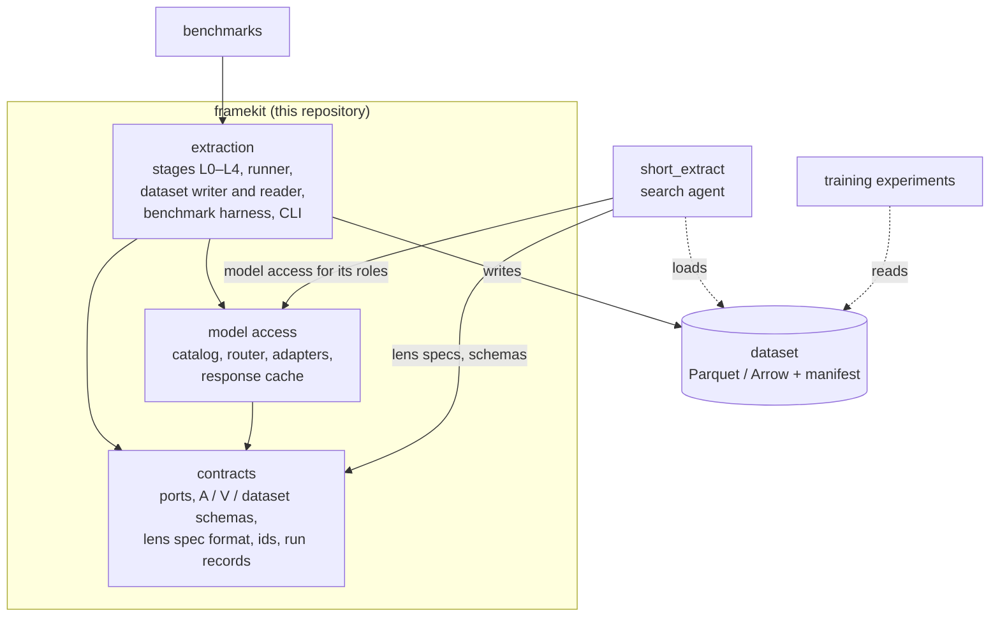
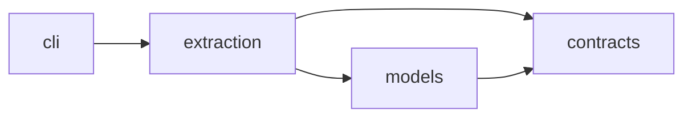
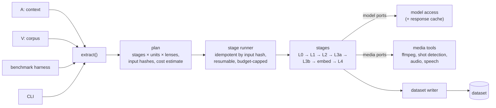
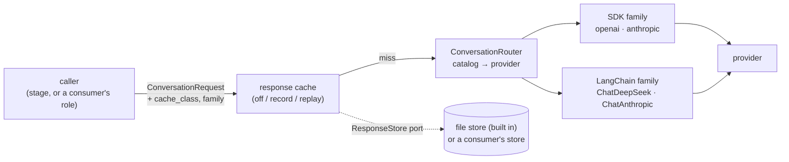

# Architecture: Layers, Packages and Consumers

How framekit's code is organized and how other projects connect to it. Written for collaborators who need the map before writing code. The functional design (what `extract(A, V)` does, stage by stage) is in [DESIGN.md](DESIGN.md); decisions are dated in [DECISIONS.md](DECISIONS.md).

> **Status:** target architecture, approved by the owner on 2026-10-23. No code yet: the first code arrives by seeding from short_extract (§7).

---

## 1. Position: one general library, several consumers

framekit is a **general library**, not a single-purpose engine: its modules are useful on their own (a project may use only `framekit.models` for LLM access, or only the dataset reader). Extraction is the first large module; others are added beside it.



| Layer | Owns | Must not |
|---|---|---|
| **contracts** | ports (`conversation`; later `video_understand`, `vision_generate`, `embed_*`), media ports, the `ResponseStore` port, the A / V / dataset schemas, the lens spec format, ids, run records | import anything else in the library, any provider SDK, or any I/O library |
| **model access** | model catalog, router, the SDK and LangChain adapter families, the response cache wrapper and its file store | know stages, datasets or lenses |
| **extraction** | stages L0–L4 + embed, the stage runner, the dataset writer and reader, the benchmark harness, the CLI | call a provider SDK directly; contain lens or corpus vocabulary |

**What the library never knows:** any consumer. No sessions, no web framework, no Postgres, no task queue, no consumer's services. A consumer depends on the library; never the other way round.

---

## 2. Packaging and packages

framekit follows the **Python library convention** (decided 2026-10-23): it's installed by other projects (the search app, training experiments, benchmarks), so it's packaged like any library they'd install, not like a deployed app.

| Aspect | Convention |
|---|---|
| Metadata | one `pyproject.toml` (PEP 621): name, version, dependencies, extras, the `framekit` script entry point |
| Build backend | `hatchling` (uv's default); builds a **wheel** and an **sdist** |
| Layout | **src layout**: the code lives in `src/framekit/`, so tests run against the installed package, never against stray files at the repo root |
| Dependencies | **loose ranges** (e.g. `pydantic>=2.6,<3`), so framekit fits into consumers' environments (a training project brings its own PyTorch, NumPy, …) |
| Heavy dependencies | **optional extras**, so consumers install only what they use |
| Lockfile | `uv.lock` is committed for framekit's own development and CI; consumers never use it, they resolve their own |
| Typing | ships `py.typed`, so consumers' type checkers see framekit's types |
| Versions | semantic versioning, git tags `vX.Y.Z`; the dataset schema version is separate and recorded in each manifest (§3) |
| Distribution | installed from the git repository at a tag (private repo); publishing wheels to a package index is a later option |

```
pyproject.toml
uv.lock
src/
  framekit/
    __init__.py    public API: extract, Dataset, schemas
    py.typed
    contracts/     ports, schemas (A, V, dataset, lens spec), ids, clock, run records, ResponseStore
    models/        catalog, router, adapters (sdk/, langchain/), cache/ (wrapper + file store)
    extraction/    stages/ (normalize, signals, segment, perceive, lens_pass, embed, qc),
                   runner/, dataset/ (writer, reader, manifest), bench/, alignment/
    cli.py         `framekit extract …`, `framekit bench …`, `framekit cache stats|wipe`
tests/
docs/
```

| Install | Adds | Typical consumer |
|---|---|---|
| `framekit` | contracts, model access (official SDKs), the dataset reader | anything reading datasets: training experiments, the search app's loader |
| `[media]` | ffmpeg bindings, scene detection, audio | running extraction |
| `[speech]` | Whisper + VAD | the `speech` perception module |
| `[langchain]` | the LangChain adapter family | the search app's conversational roles |

**Modules, not packages.** A new capability (say, a training-data helper or a new kind of processing) is added as a new subpackage under `src/framekit/`, with its own import contract and, if it brings heavy dependencies, its own extra. It becomes a separate package only when a consumer needs it without the rest *and* the extras can't provide that (e.g. conflicting dependency ranges).

**Training experiments** read datasets as plain Parquet / Arrow, so they can use whatever training stack they choose (Hugging Face `datasets`, PyTorch, Polars, …). framekit never depends on a training framework; any training helpers would be a separate optional extra, decided when an experiment needs one.

### 2.1 Dependency rules (import-linter)



| Contract | Rule |
|---|---|
| Layers | `cli` → `extraction` → `models` → `contracts` |
| Contracts are pure | `contracts` imports no provider SDK, LangChain, media library, or I/O framework |
| Provider SDKs and LangChain | only inside `models` adapters |
| Media libraries (ffmpeg bindings, scene detection, audio, Whisper) | only inside `extraction.stages` behind media ports |
| LangGraph | nowhere |
| No consumer code | no import of any consumer package, web framework, ORM or queue library |

A **vocabulary test** scans library code (and prompt, JSON and text files shipped with it) for known lens and corpus terms. Example lens specs and corpus profiles used by tests live under `tests/fixtures/`, outside the scan, and contain no footage.

---

## 3. Public API

| Surface | Shape |
|---|---|
| **Function** | `extract(context: ExtractionContext, corpus: Corpus, *, models: ModelProfile, runner: Runner = LocalRunner(), out: Path, cache: ResponseStore | None = None) -> Dataset` |
| **Schemas** | `ExtractionContext` (A), `Corpus` + `CorpusProfile` (V), `LensSpec`, `ModelProfile`, `DatasetManifest`: Pydantic models, versioned with the dataset schema |
| **Dataset** | `Dataset.open(path)` → typed readers per table (Arrow); `manifest` |
| **Model access** | `ConversationRouter`, `ConversationRequest` / `ConversationResult`, `with_cache(port, store, settings)`; the same API consumers use for their own roles |
| **CLI** | `framekit extract --context a.yaml --corpus v.yaml --out ./ds`; `framekit bench …`; `framekit cache stats|wipe` |

Changing a public schema or port is a **release** with a version bump; the dataset manifest records the schema version so readers can refuse or migrate old datasets.

---

## 4. Inside `extract()`



- **Plan:** expands A × V into tasks and their input hashes; tasks whose run record already exists are skipped. The plan gives the cost estimate checked against the budget.
- **Runner:** executes tasks with bounded parallelism and shared per-provider rate limits. Writes the run record before scheduling dependants, so a crash resumes cleanly. `LocalRunner` first; a distributed runner later, behind the same port (DESIGN.md §5.2).
- **Working store:** intermediate artifacts (normalized copies, chunk files, per-task outputs, run records) live in a local work directory next to the output, keyed by input hash. It's a cache: deleting it costs only recomputation.
- **Writer:** turns task outputs into the dataset tables and the manifest.

---

## 5. Model access



- **Catalog:** one entry per model: provider, wire protocol, context window, structured-output method, the reasoning switches (`ReasoningControl`), the LangChain class. Reasoning is off unless a request asks for it.
- **Two adapter families behind one port:** the SDK family (official `openai` and `anthropic` SDKs) and the LangChain family. Both share a base that owns the key check, output budget, timing, error mapping, stop-reason normalization and the result.
- **Keys** come from the environment only (`HIVE_API_KEY`, `DEEPSEEK_API_KEY`, `ANTHROPIC_API_KEY`); never in files, never logged.
- **Response cache:** keyed by the request (including model and method) per cache class; replays are marked `cached`, cost 0, adapter version suffixed `+cache`. The store is a port: the library ships a file store; a consumer may plug in its own (short_extract uses Valkey).
- `video_understand`, `vision_generate` and `embed_*` are added the same way when E1 needs them.

This stack is seeded from short_extract, where it's built and tested today (§7).

---

## 6. How consumers connect

- **Dependency:** consumers install the library from its git repository at a **release tag**, with the extras they need. With uv:
  ```toml
  [project]
  dependencies = ["framekit[langchain]"]

  [tool.uv.sources]
  framekit = { git = "https://github.com/edyhtan/framekit", tag = "v0.1.0" }
  ```
  A contract change means a library release, then a version bump in the consumer.
- **short_extract (the search agent):**
  - uses model access for its Interpreter, Responder and digest roles, exactly as before the move;
  - reads lens specs with the library's loader (query mapping, specificity rules, rubric);
  - never runs stages: it **loads datasets** into Postgres + pgvector with its own loader;
  - provides a Valkey `ResponseStore` for its cache.
- **Benchmarks and training experiments:** install the base package (plus `[media]` to run extraction themselves), use `extract` and `Dataset.open`, or read the Parquet files directly. Experiment code lives in the consumer, not in this repo. Datasets and trained models stay local per the rights rule (DESIGN.md §8).

---

## 7. Seeding plan

framekit's first code comes from short_extract, keeping its history:

| Step | Repository | Work |
|---|---|---|
| 1. Restructure in place | short_extract | Gather contracts into `engine/core` and model access into `engine/models` (transitional folders), introduce the `ResponseStore` port, new import contracts. Behavior-preserving. |
| 2. Seed this library | this repo | `git subtree split` of `engine/core` + `engine/models`, merged here; move them into `src/framekit/` per §2 and write the library `pyproject.toml` (hatchling, ranges, extras); add tooling (pytest, ruff, import-linter contracts, vocabulary test) and CI. Tag **`v0.1.0`**. |
| 3. Depend on the library | short_extract | Replace the local copies with this library at `v0.1.0`. Behavior-preserving. |

Then extraction (E1 onward, DESIGN.md §7) is built here.

**Acceptance for step 2:** the moved tests pass here unchanged in count; `uv build` produces a wheel, and a fresh environment can install it from the tag and import the public API; `lint-imports` and `ruff` pass; a cache record → replay round trip works with the file store; no file in the repository contains footage, frames or keys.

---

## 8. Open decisions

- **Name clash on PyPI:** an unrelated, active package named `framekit` exists there. Installing from git is unaffected, but publishing would need another distribution name (e.g. `framekit-ml`), and a project must not install both (same import name). Decide before any publishing.
- Publishing wheels to a package index (instead of git tags), if the repo goes public or installs from git get slow.
- Dataset layout details, A / V schema details, lens spec file format (DESIGN.md §9).
- Distributed runner technology, once corpus size needs it.
- Video, text and embedding models (DESIGN.md §9).
