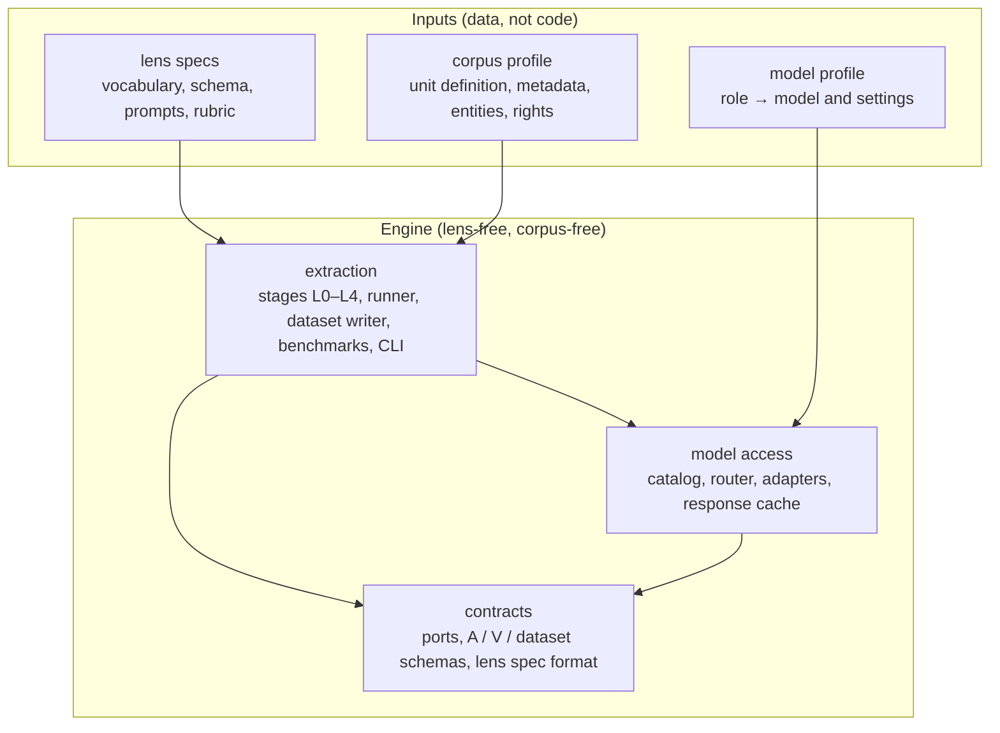
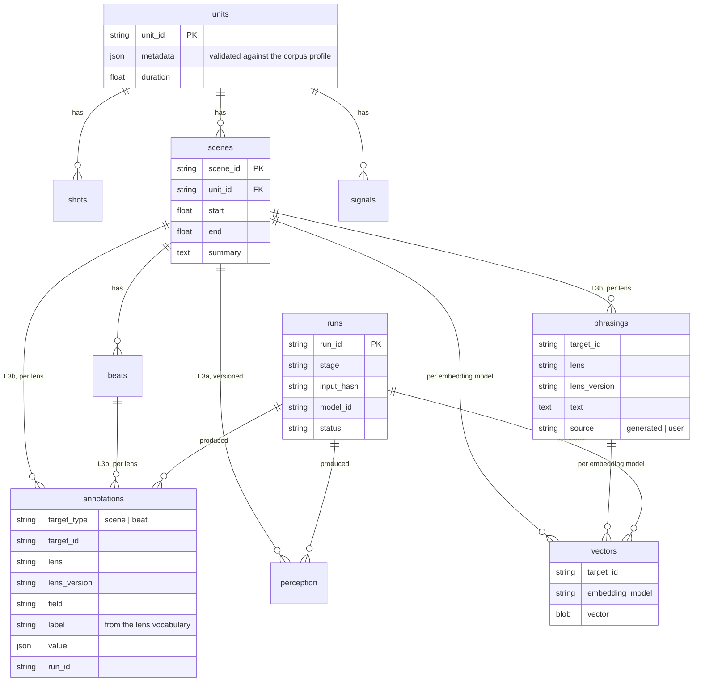
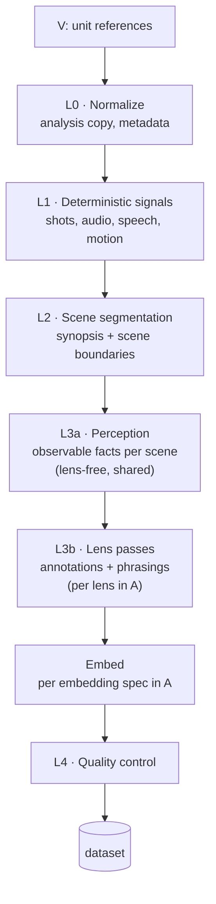
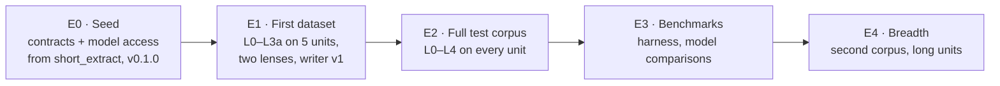

# Video Extraction Engine — Design

A general-purpose library and CLI that turns a video corpus into a **dataset**: segments with timestamps, text describing them, vectors, and the provenance of every value. Its whole job is one function:

> **`extract(A, V) → dataset`**: given **A**, the extraction context (what to extract), and **V**, a video corpus, produce a dataset of segments, text, vectors and provenance.

**What gets extracted is not built into the engine.** It's defined by **lens specs**: declarative data (schema, vocabulary, prompts, rubric) passed inside A. The engine is corpus-neutral too: any video library plugs in through a **corpus profile**, part of V.

**Consumers:**
- the **video clip search agent** ([`short_extract`](https://github.com/edyhtan/short_extract)), which loads datasets into Postgres + pgvector and searches them;
- **benchmarks**: reproducible, comparable datasets for evaluating perception, lens passes and retrieval;
- **experimental model training**: phrasing ↔ segment pairs, annotation labels, embeddings.

Examples in this document use one reference corpus and one reference lens. They are illustrations, not dependencies; nothing outside the appendices relies on them:
- **Example corpus:** classic Tom and Jerry shorts (Appendix A).
- **Example lens:** emotions & dynamics (Appendix B).

How the code is organized: [ARCHITECTURE.md](ARCHITECTURE.md). Why it looks this way: [DECISIONS.md](DECISIONS.md).

---

## 0. Principles

### 0.1 Layers



**Rule:** engine code and the dataset schema never reference a lens concept (emotion, dynamic, situation, gag, …) or a corpus concept (a corpus's unit type, eras, character names, …; for the example corpus: short, era, Tom). Anything lens- or corpus-specific enters only through the lens spec (§4) or the corpus profile (§1). A CI check greps engine code for known lens and corpus terms.

The engine knows only: **units** (source files), **shots**, **scenes**, **beats**, **signals**, **perception records**, **annotations** (opaque, lens-validated), **phrasings** (query-shaped text per lens), **vectors** and **runs**.

### 0.2 Model-agnostic rule

Stages never call a model provider directly. They call **ports** by capability:

| Port | Used by |
|---|---|
| `video_understand` (whole unit or scene → structured output) | L2, L3a |
| `vision_generate` (frames + text → structured output) | L3a fallback |
| `conversation` (system prompt + message history → text or structured output; single calls are one-turn conversations) | L3b lens passes, L2 merge, QC self-consistency |
| `embed_text`, `embed_image` | the embedding stage |

- **Adapters** implement ports per provider; a **model profile** (in A) maps each role to a model and settings. Swapping a model is a config change.
- Adapters declare **capabilities** (native video, image limits, structured output, batch, context size). If a model lacks one, the engine picks a documented fallback (e.g. video → sampled frames) or refuses at startup. It never branches silently.
- Prompts are provider-neutral. Any provider-specific formatting stays in the adapter.
- **Provenance:** every model output records `model_id` and adapter version. Changing a model creates new versions of perception, annotations or vectors; it never overwrites. Vectors are keyed by embedding model, and caches include the model in their key.
- Consumers (such as the search agent) use the same model access for their own roles; the `conversation` port is shared.

### 0.3 Perception and interpretation are separate passes

The video model only records what is **observable** (L3a). Every interpretation is a **text-only lens pass** (L3b) over those records. So lenses can be added, revised and re-run without re-watching video, and a new lens on an already-perceived corpus costs text calls only.

---

## 1. Goals and constraints

**Goals**
- One call, `extract(A, V)`, produces a self-describing dataset that any consumer can read without this library's internals.
- Lens- and corpus-neutral: a new lens or corpus is new data, never new engine code.
- Reproducible: the same A and V, with the same models, give the same dataset; a response cache makes reruns free and deterministic.
- Resumable and incremental: a failed or interrupted run continues where it stopped; adding a lens re-runs only L3b and later.

**Constraints (all corpora)**
- Units are the **reference and are never split as a reference**. Every timestamp in the dataset is on the unit's timeline. For processing, the normalized copy may be split into **chunk files**: derived, cacheable processing artifacts (same rights handling as the normalized copy), with every output mapped back onto the unit timeline.
- Original source files are never modified; analysis uses normalized copies.
- Each corpus declares a **rights mode**: `byo_media` (users supply their own copies; no footage hosted, §8) | `hosted` (owned, licensed or public-domain corpus) | `embed` (official embeds only).

**Corpus profile** (data, part of V). Every corpus supplies the same fields; the engine reads nothing else about it:

| Field | Meaning |
|---|---|
| unit definition | what one source file is (film, episode, short, lecture, match, …) and rules for it |
| metadata fields | per-unit fields and allowed values, validated into the dataset's units table |
| entity reference list | recurring people, characters or objects perception should name consistently |
| perception hints | corpus traits that affect L1–L3a (e.g. dialogue-free, animation artifacts) |
| manifest | unit IDs, expected durations, fingerprints, excluded ranges |
| source releases | which release or edition is indexed, and its quality |
| rights mode | `byo_media` \| `hosted` \| `embed` |

Appendix A is a worked example (Tom and Jerry).

---

## 2. Inputs and output

```python
dataset = extract(context=A, corpus=V, models=profile, runner=LocalRunner(), out=path)
```

| Argument | Contents |
|---|---|
| **A**, the extraction context | intent text; **lens specs as data** (§4); perception modules to run; segmentation settings; embedding spec(s); model profile; budget |
| **V**, the corpus | the corpus profile (§1); the units as **references** to media files (paths or URIs), never copies |
| **output: dataset** | see §2.1 |

### 2.1 The dataset

Vectors alone can't be trained on or evaluated, because you'd lose what they encode. So the dataset keeps text and provenance next to the vectors.

| Part | Contents |
|---|---|
| **segments** | units → shots → scenes → beats, with start and end on the unit timeline; unit metadata validated against the profile |
| **signals** | L1 deterministic signals per unit (shot cuts, audio onsets and tags, speech segments, motion intensity) |
| **text** | perception records (L3a core + modules), annotations (per lens and lens version), phrasings (per lens), the unit synopsis |
| **vectors** | per embedding model, keyed by segment or phrasing; the model ID is part of the key |
| **provenance** | model IDs, adapter versions, lens versions, input hashes, run records (status, attempts, times, tokens, cost), QC results |

- **Format:** Parquet / Arrow tables plus a **manifest** (dataset ID, A and V digests, lens versions, model IDs, schema version, row counts, checksums). Layout details are open (§9).
- **Versioned, never overwritten:** re-running a lens adds a new `lens_version`; changing a model adds new rows keyed by the new `model_id`. Old versions stay until retired.



### 2.2 How consumers use it

| Consumer | Uses |
|---|---|
| **Search agent** (short_extract) | loads a dataset into Postgres + pgvector (its own loader); reads the same lens specs for query mapping, specificity, retrieval weights and the judge rubric |
| **Benchmarks** | the benchmark harness (§6.2) compares datasets from different models, prompts or lens versions on gold sets |
| **Training experiments** | phrasing ↔ segment pairs, annotation labels and vectors as training data, subject to the rights rule (§8) |

---

## 3. Extraction pipeline



Stages L0–L3a depend only on V, the perception modules and the model profile, so their output is **shared** by every A over the same corpus. L3b and later depend on the lens specs.

### L0 — Normalize
- Keep originals untouched.
- Analysis copy with ffmpeg: constant fps, 480–720p.
- Record the metadata fields the corpus profile declares; match each file to the manifest (§8.2).

### L1 — Deterministic signals (no LLM)
- **Shot boundaries:** TransNetV2 or PySceneDetect AdaptiveDetector (tuned per corpus; animation smear frames cause false cuts). Snapping points for clean cuts.
- **Audio:** librosa onsets and loudness peaks; an audio tagger (PANNs / BEATs); Whisper **with VAD** for speech (it hallucinates over music without VAD).
- **Motion intensity:** optical-flow magnitude per second.

### L2 — Scene segmentation
- A long-context video model gets the whole unit at ~1 fps and returns a **synopsis** plus **scene boundaries** (30–60 s), snapped to L1 shot cuts.
- The synopsis is passed to later passes, because a scene's meaning depends on unit context.

### L3a — Perception (video → observable facts)
- Input per scene: frames at ~2 fps, L1 signals, the synopsis, the entity reference list from the corpus profile.
- Output: a **core record** plus **optional modules**. No interpretation.

| Part | Contents |
|---|---|
| core | summary, setting, entities, props, beats `{t, who, action, audio}` |
| module `camera` | shot sizes, camera moves, cuts |
| module `timing` | holds, pauses, rhythm relative to music |
| module `sound` | music cues, silence, sound–action sync |
| module `speech` | transcript segments (from L1 Whisper) |

Lens specs declare which modules they need (§4). A lens needing a missing module triggers a targeted re-run of that module only. Example core record (from the example corpus, Appendix A; field names are generic, values are corpus-specific):

```json
{
  "scene_id": "tj042_s05",
  "summary": "Tom builds a mousetrap contraption; each attempt injures him instead",
  "setting": "living room",
  "entities": ["Tom", "Jerry"],
  "props": ["mousetrap", "toothpick"],
  "beats": [
    {"t": [152.0, 156.5], "who": "Tom", "action": "sets trap, rubs hands, grins"},
    {"t": [156.5, 158.0], "who": "Jerry", "action": "nudges trap with a toothpick"},
    {"t": [158.0, 160.2], "who": "Tom", "action": "trap snaps on his hand, freezes, then screams",
     "audio": "snap, scream"}
  ]
}
```

### L3b — Lens passes (facts → annotations)
For each lens spec in A, a text-only pass reads the L3a records and produces, per scene and per beat:
- **annotations** conforming to the lens's output schema and vocabulary;
- **phrasings**: query-shaped sentences a user of this lens would type to find the moment (doc2query).

The engine stores both without understanding them.

### Embed
- Text vectors for scene summaries and phrasings (per lens); image vectors for keyframes (e.g. SigLIP), per the embedding spec in A.
- Every vector is keyed by its embedding model. Image vectors from a `byo_media` corpus stay local (§8).

### L4 — Quality control
- **Engine checks:** beat timestamps inside the scene and ordered; entities in the corpus profile's list; perception modules complete.
- **Lens checks:** every label in the lens vocabulary; output validates against the lens schema; validators declared in the lens spec.
- **Self-consistency:** run each lens pass twice; flag or down-weight scenes whose annotations disagree.
- QC results are part of the dataset's provenance; failing rows are flagged, not silently dropped.

### Cost
- Perception (L2/L3a) is the expensive, video-bound part and runs once per corpus and model (plus targeted module re-runs).
- Lens passes are cheap text calls; adding or iterating a lens never touches video.
- A cost estimate is shown before a run, and the budget in A caps it.

---

## 4. Lens specs (declarative)

A lens is **data**: a spec file plus prompt files, versioned. The engine validates it against the lens spec format (a contract) at load time. Some fields drive extraction; the rest are carried for consumers, so one spec serves both sides.

| Item | Used by |
|---|---|
| name, version, description, example queries | registry, consumers' routing |
| vocabulary (fixed, versioned) + output schema | L3b, L4 validation; consumers' filters |
| required perception modules | L3a scheduling |
| interpretation prompt | L3b |
| phrasing prompt (doc2query) | L3b |
| validators, gold set | L4, benchmarks |
| query mapper, specificity rules, retrieval weights, judge rubric, critique mapping, abstention thresholds | **consumers** (e.g. the search agent); carried, not used by extraction |

**Rules**
- Vocabularies are fixed and validated. Never write free-text labels into annotations.
- A lens pass reads perception records only (and, when re-running, its own earlier annotations). Lenses never read each other's output; cross-lens composition is a consumer's job.
- File format (YAML or JSON plus prompt files) is open (§9).
- Candidate lenses: emotions & dynamics (Appendix B), comedy craft, cinematography, narrative function, sound design, content safety.

---

## 5. Running extraction

### 5.1 The stage runner
- **Idempotent tasks keyed by input hash.** A task's input hash covers its inputs, model ID and stage version, so re-running a finished task is a no-op, and a changed input re-runs only what depends on it.
- **Resumable:** every outcome is written as a run record before the next stage starts; an interrupted run continues from the records.
- **Response cache:** model calls can be recorded and replayed (off / record / replay per call class). A replay is free and deterministic, which makes benchmarks and tests reproducible. The cache store is a port (file store built in; consumers may supply another, e.g. Valkey).
- **Budgets and rate limits:** the budget in A caps cost; per-provider rate limits are shared across stages.

### 5.2 Runners
The runner is behind a port, so the same stages run in different places:

| Runner | Use |
|---|---|
| `LocalRunner` | one process, async I/O, bounded parallelism; the default for the CLI, tests and benchmarks |
| distributed runner (later) | media, model and embedding work fanned out to workers through a task queue; chosen when corpus size requires it |

Work splits naturally into **media work** (L0, L1, chunk files: CPU and disk bound, parallel across units), **model work** (L2, L3a, L3b: parallel, capped by provider rate limits) and **embedding work** (small and fast).

### 5.3 Long units (future scope, up to 1 h)
- Process long units in **chunks of ~10 min**: chunk boundaries at shot cuts from whole-file L1, with 1–2 min overlap. Chunks are processing windows only: chunk files cut from the normalized copy are cacheable processing artifacts (so a failed chunk re-runs without re-splitting), the source is never modified, and every timestamp still references the full unit.
- **Two-pass L2:** per-chunk scene detection and summaries in parallel, then a text-only merge. The merge shifts timestamps onto the unit timeline, removes duplicate scenes from overlaps, renumbers scenes, reconciles entities and writes one unit synopsis. If the chosen video model accepts a full hour, L2 stays a single call (an adapter capability).
- L3a / L3b run per scene **after** the merge, with the unit synopsis. Vectors need no merging: they are per scene or phrasing on the unit timeline.
- Chunk tasks run in parallel, and a merge task waits for all of them. Cost is ~6× a 10-min unit plus 10–20% for overlaps. Wall-clock is ~15–30 min per hour of video with enough parallelism.
- **Boundary evaluation:** gold moments placed across chunk boundaries must be found as reliably as moments inside chunks.

---

## 6. Evaluation and benchmarks

### 6.1 Quality of extraction
Per corpus × lens:
- a **gold set** (~10 hand-annotated scenes to start): label agreement, self-consistency, vocabulary validity;
- perception checks: entity naming consistency against the profile, beat timestamp accuracy on a sample.

**Engine contract test:** the engine must run end to end with a second, minimal lens spec without code changes.

### 6.2 Benchmark harness
- Runs `extract` over a fixed V with variants of A (model profile, prompts, lens version) and scores each dataset against the gold sets.
- Uses the response cache so a variant that only changes later stages replays earlier calls for free.
- Reports per-stage cost, tokens, latency and quality side by side. Results are local files, never published footage.
- Retrieval benchmarks (does a query find the gold moment?) belong to consumers, but the harness exposes datasets in a form they can score.

---

## 7. Roadmap

Milestones run on a **test corpus**; the current choice is the example corpus (Appendix A). Swapping it for another profile must not change the plan.



**E0: seed the library**
- Contracts (ports, ids, run records, the response-store port) and model access (catalog, router, SDK and LangChain adapter families, response cache) are moved here from short_extract with `git subtree split`, keeping their history. Tag `v0.1.0`. See [ARCHITECTURE.md](ARCHITECTURE.md) §7.

**E1: first dataset (5 units of the test corpus)**
- A, V and dataset schemas; lens spec format and loader.
- L0–L3a end to end with the corpus profile and modular perception.
- Emotions & dynamics lens (Appendix B) with a ~10-scene gold set, plus a **minimal second lens** (e.g. comedy craft, ~10 labels) on the same scenes, purely to prove the engine has no lens leakage.
- Dataset writer and reader v1; CLI `extract`.

**E2: full test corpus**
- L0–L4 on every unit (~161 units, ~19 h for the example corpus); the search app loads the result.

**E3: benchmarks**
- Benchmark harness (§6.2); compare video and embedding models on the gold sets.

**E4: breadth**
- A second corpus via a new profile (e.g. a public-domain silent-comedy set in `hosted` mode).
- Long units in chunks (§5.3).

---

## 8. Rights and distribution

Code is corpus- and lens-agnostic. Corpus profiles and lens specs ship as data, separately from the engine.

### 8.1 What may leave the machine

| Artifact | `byo_media` corpus | `hosted` corpus |
|---|---|---|
| footage, frames, keyframes, thumbnails, normalized copies, chunk files | **local only, never published** | per the corpus licence |
| image vectors | local only | per the licence |
| segments, signals, perception text, annotations, phrasings, text vectors | local by default; may be published as an **annotation pack** (CC-BY, no frames) | per the licence |

- A dataset from a `byo_media` corpus holds no footage or frames, but it does hold derived text and image vectors. It stays local unless the corpus's rights mode allows otherwise. **Training on it follows the same rule.**
- Never in this repository: footage, frames, thumbnails or sample clips (including README screenshots and test fixtures) from a `byo_media` corpus; ripping or decryption tools or instructions; YouTube download scripts (yt-dlp); third-party characters or trademarks in the project name or logo.
- Test fixtures use synthetic media generated in tests (e.g. ffmpeg test patterns and tones).

### 8.2 File matching and alignment (`byo_media`)
Users' copies of a corpus differ (releases, edits, frame rates). A dedicated module, with tests:
- identifies user files by duration, then audio fingerprint (Chromaprint), with a perceptual frame hash as tiebreaker;
- aligns them to the reference timeline with audio cross-correlation (`offset`, `drift`, piecewise for censored releases): `t_user = t_ref * drift + offset`;
- reports coverage; unmatched units are excluded from the dataset.

### 8.3 Packaging
- Code: MIT or Apache-2.0. Annotation packs: CC-BY, stating they contain no footage. README disclaimer: not affiliated with any rights holder.

---

## 9. Open decisions

- **Video model** for L2/L3a (Gemini assumed; Claude via frames is an option; verify cost and limits).
- **Text model** for lens passes; **embedding models** (text + SigLIP).
- **A and V schemas in detail,** including the lens spec file format (YAML or JSON plus prompt files).
- **Dataset layout details:** table split, partitioning, manifest fields.
- **Package layout** inside this repository (proposed in [ARCHITECTURE.md](ARCHITECTURE.md) §2).
- **Distributed runner** technology, when it's needed.
- Per lens: see the lens appendix (e.g. base emotion taxonomy in Appendix B).

---

## Appendix A — Example corpus profile: Tom and Jerry

A filled-in instance of the corpus profile template (§1), used as the test corpus. Everything here is specific to this corpus and lives in its profile; none of it belongs in engine code.

- **Unit:** the **short**, a complete original theatrical cartoon. Never a TV "episode" (which bundles and often edits shorts). One file per short; never concatenate.
- **Size:** ~114 Hanna-Barbera MGM (1940–58), 13 Gene Deitch (1961–62), 34 Chuck Jones (1963–67); ≈161 shorts × ~7 min ≈ 19 h.
- **Metadata:** title, year, era (`hanna_barbera` | `deitch` | `jones`), runtime, release source, `source_quality`.
- **Entity list:** Tom, Jerry, Spike, Tyke, Butch, Nibbles/Tuffy, Toodles, …
- **Rights mode:** `byo_media`. Owned by Warner Bros. Discovery and still under copyright; the earliest (1940) should reach US public domain on 2036-01-01. Personal, non-commercial use of owned copies only.
- **Perception hints:** almost dialogue-free; the soundtrack (music + effects) carries much of the meaning, so L1 audio matters; smear frames inflate shot-cut counts.

**Source media**

| Era | Shorts | Release | Format |
|---|---|---|---|
| Hanna-Barbera, 1940–58 | 114 | *Tom and Jerry: The Golden Era Anthology* (Warner Archive, Dec 2025), uncut, uncensored, chronological | Blu-ray 1080p (preferred) / DVD |
| Gene Deitch, 1961–62 | 13 | *Tom and Jerry: The Gene Deitch Collection* (2015), remastered | DVD |
| Chuck Jones, 1963–67 | 34 | *Tom and Jerry: The Chuck Jones Collection* (2009) | DVD |

- Many pre-1951 negatives were lost in the 1978 George Eastman House fire; record `source_quality`.
- Some releases censor scenes (e.g. Mammy Two Shoes redubs and edits); record the release indexed. Verify the Deitch and Jones sets are unedited.
- One file per title (avoid "play all" streams). Keep the MGM lion, title and end cards in the file, marked as `excluded_ranges`.
- Preserve the original aspect ratio (CinemaScope shorts are widescreen); never crop or stretch.
- The project does not include or document ripping or decryption tools.

---

## Appendix B — Example lens: emotions & dynamics

**Purpose:** a user describes a real-life situation or feeling; a consumer finds the moment whose emotional and interpersonal structure mirrors it. The lens works on any corpus; the sample output below uses the example corpus (Appendix A).

**Output schema (per scene and beat)**
- **Emotions** per entity and for the **viewer** (e.g. one character = smug, viewer = schadenfreude), with intensity (1–5) and valence.
- **Dynamics** from the fixed vocabulary below.
- **Structure:** parties, roles, outcome, arc (who wins, who is in control, whether it loops).
- **Phrasings** ("relatable situations"): 5–10 real-life situations the moment could describe. User queries look like these, not like descriptions of the footage.

```json
{
  "scene_id": "tj042_s05",
  "emotions": {
    "Tom": [{"label": "frustration", "intensity": 4}],
    "Jerry": [{"label": "smugness", "intensity": 3}],
    "viewer": [{"label": "schadenfreude", "intensity": 4}]
  },
  "dynamics": ["futile_effort", "backfire", "overconfidence_punished"],
  "structure": {"parties": 2, "roles": ["schemer", "saboteur"], "outcome": "schemer_loses", "arc": "escalating_loop"},
  "phrasings": [
    "every fix I push breaks something else",
    "planning a perfect surprise that goes wrong",
    "trying to outsmart the system and getting burned"
  ]
}
```

**Vocabulary**
- Emotions: GoEmotions (27) or Plutchik as a base (open decision), plus interpersonal additions: schadenfreude, smugness, betrayal, helplessness, spite, petty satisfaction, dread.
- Dynamics (starting set, target 30–50): `futile_effort`, `backfire`, `false_security`, `escalation`, `cycle_of_retaliation`, `truce_broken`, `underdog_wins`, `overconfidence_punished`, `collateral_damage`, `sabotage`, `uneasy_alliance`, `last_minute_rescue`, `pretend_everything_is_fine`, `blame_shifting`, `bait_and_switch`, `caught_red_handed`, `common_enemy`.
- Built bottom-up: the LLM proposes labels on a sample, merged by hand, then re-tagged with the fixed list.

**Required perception modules:** core, `sound` (optional, helps intensity).

**Consumer fields (carried in the spec, used by the search agent):**
- **Query mapping:** emotions alone are too coarse ("anger" matches hundreds of clips). Always map to **emotion + whose emotion + intensity + dynamic** together, plus a rewritten phrasing for embedding.
- **Specificity rules:** too broad ("life", "work is hard") → structure comes back mostly empty → narrow or decline. Too specific → strip details to the dynamic.
- **Judge rubric:** "Would a viewer instantly get why this clip represents this situation?"
- **Critique mapping:** "funnier", "less violent", "more hopeless", "the underdog should lose" → field and weight changes; "it's not about revenge" → reject the reading.

**Eval notes:** seed gold sets with moments the internet already uses as reactions or memes, if the corpus has them. Expected strengths: universal dynamics (backfire, escalation, futile effort, false security). Expected weaknesses: dialogue-dependent or internal states (e.g. impostor syndrome).
