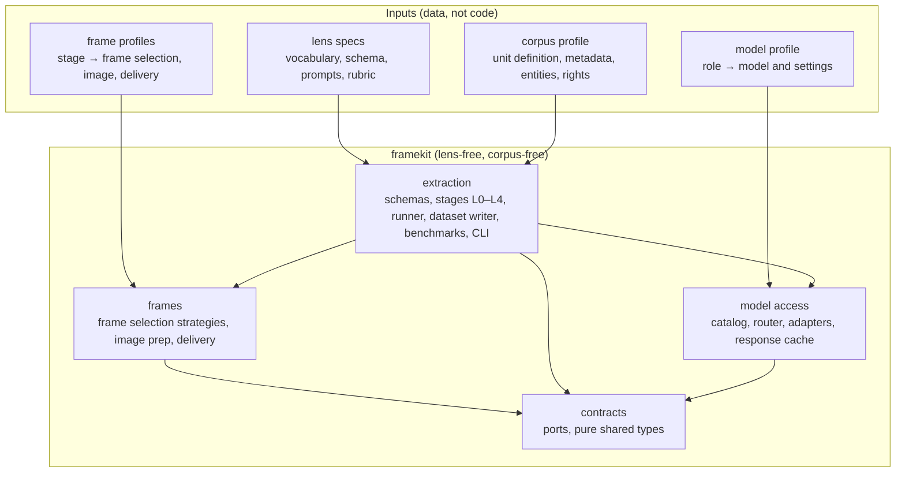
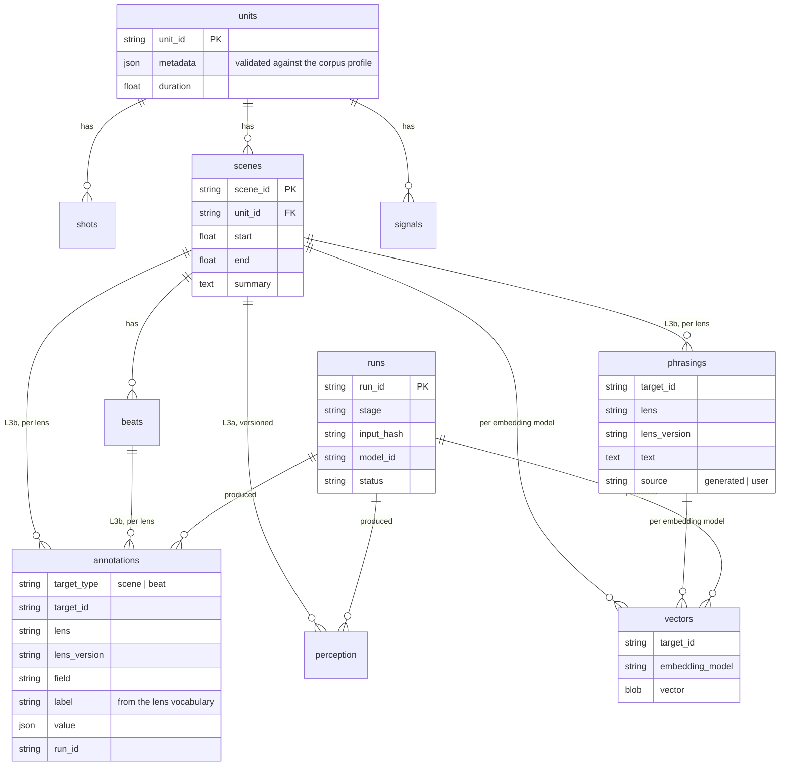
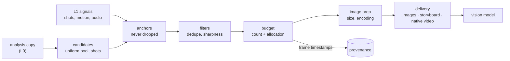
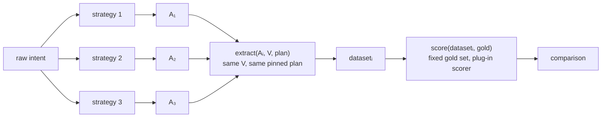
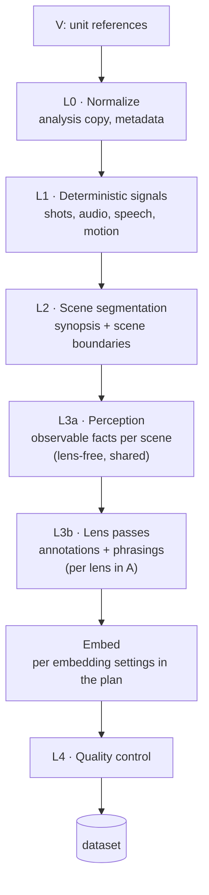
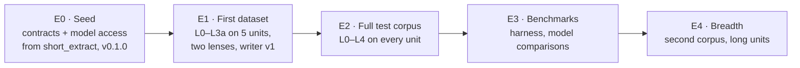

# framekit — Design

framekit is a general-purpose library of AI building blocks for video datasets: provider-neutral **contracts**, **model access**, and **extraction** ([ARCHITECTURE.md](ARCHITECTURE.md) §1). This document is the functional design; most of it is about extraction, which turns a video corpus into a **dataset**: segments with timestamps, text describing them, vectors, and the provenance of every value. Extraction's job is one function:

> **`extract(A, V) → dataset`**: given **A**, a description of the search space (what should become findable), and **V**, a video corpus, produce a dataset of segments, text, vectors and provenance.

A is **given input**: framekit doesn't create or augment it, so different ways of producing A can be benchmarked against each other on the same corpus (§2.4). **How** A is realized (frame sampling, segmentation, models, quality rules) is a separate **plan**.

**What gets extracted is not built into framekit.** It's defined by **lens specs**: declarative data (schema, vocabulary, prompts, rubric) passed inside A. framekit is corpus-neutral too: any video library plugs in through a **corpus profile**, part of V.

**Consumers:**
- the **video clip search agent** ([`short_extract`](https://github.com/edyhtan/short_extract)), which loads datasets into Postgres + pgvector and searches them;
- **benchmarks**: reproducible, comparable datasets for evaluating perception, lens passes and retrieval;
- **experimental model training**: phrasing ↔ segment pairs, annotation labels, embeddings.

Examples in this document use one reference corpus and one reference lens. They are illustrations, not dependencies; nothing outside the appendices relies on them:
- **Example corpus:** classic Tom and Jerry shorts (Appendix A).
- **Example lens:** emotions & dynamics (Appendix B).

How the code is organized: [ARCHITECTURE.md](ARCHITECTURE.md). Why it looks this way: [DECISIONS.md](DECISIONS.md).

---

## 0. Principles

### 0.1 Layers



**Rule:** library code and the dataset schema never reference a lens concept (emotion, dynamic, situation, gag, …) or a corpus concept (a corpus's unit type, eras, character names, …; for the example corpus: short, era, Tom). Anything lens- or corpus-specific enters only through the lens spec (§4) or the corpus profile (§1). A CI check greps library code for known lens and corpus terms.

framekit knows only: **units** (source files), **shots**, **scenes**, **beats**, **signals**, **perception records**, **annotations** (opaque, lens-validated), **phrasings** (query-shaped text per lens), **vectors** and **runs**.

### 0.2 Model-agnostic rule

Stages never call a model provider directly. They call **ports** by capability:

| Port | Used by |
|---|---|
| `video_understand` (whole unit or scene → structured output) | L2, L3a |
| `vision_generate` (frames + text → structured output) | L3a fallback |
| `conversation` (system prompt + message history → text or structured output; single calls are one-turn conversations) | L3b lens passes, L2 merge, QC self-consistency |
| `embed_text`, `embed_image` | the embedding stage |

- **Adapters** implement ports per provider; a **model profile** (in the plan) maps each role to a model and settings. Swapping a model is a config change.
- Adapters declare **capabilities** (native video, image limits, structured output, batch, context size). If a model lacks one, framekit picks a documented fallback (e.g. video → sampled frames) or refuses at startup. It never branches silently.
- Prompts are provider-neutral. Any provider-specific formatting stays in the adapter.
- **Provenance:** every model output records `model_id` and adapter version. Changing a model creates new versions of perception, annotations or vectors; it never overwrites. Vectors are keyed by embedding model, and caches include the model in their key.
- Consumers (such as the search agent) use the same model access for their own roles; the `conversation` port is shared.

### 0.3 Perception and interpretation are separate passes

The video model only records what is **observable** (L3a). Every interpretation is a **text-only lens pass** (L3b) over those records. So lenses can be added, revised and re-run without re-watching video, and a new lens on an already-perceived corpus costs text calls only.

---

## 1. Goals and constraints

**Goals**
- One call, `extract(A, V)`, produces a self-describing dataset that any consumer can read without this library's internals.
- Lens- and corpus-neutral: a new lens or corpus is new data, never new library code.
- Reproducible: the same A and V, with the same models, give the same dataset; a response cache makes reruns free and deterministic.
- Resumable and incremental: a failed or interrupted run continues where it stopped; adding a lens re-runs only L3b and later.

**Constraints (all corpora)**
- Units are the **reference and are never split as a reference**. Every timestamp in the dataset is on the unit's timeline. For processing, the normalized copy may be split into **chunk files**: derived, cacheable processing artifacts (same rights handling as the normalized copy), with every output mapped back onto the unit timeline.
- Original source files are never modified; analysis uses normalized copies.
- Each corpus declares a **rights mode**: `byo_media` (users supply their own copies; no footage hosted, §8) | `hosted` (owned, licensed or public-domain corpus) | `embed` (official embeds only).

**Corpus profile** (data, part of V). Every corpus supplies the same fields; framekit reads nothing else about it:

| Field | Meaning |
|---|---|
| unit definition | what one source file is (film, episode, short, lecture, match, …) and rules for it |
| metadata fields | per-unit fields and allowed values, validated into the dataset's units table |
| entity reference list | recurring people, characters or objects perception should name consistently |
| perception hints | corpus traits that affect L1–L3a (e.g. dialogue-free, animation artifacts) |
| manifest | unit IDs, expected durations, fingerprints, excluded ranges |
| source releases | which release or edition is indexed, and its quality |
| rights mode | `byo_media` \| `hosted` \| `embed` |

Appendix A is a worked example (Tom and Jerry).

---

## 2. Inputs and output

```python
dataset = extract(A, V, plan=plan, runner=LocalRunner(), out=path)
```

| Argument | Contents |
|---|---|
| **A**, the search space | **given input** describing what should become findable in this corpus (§2.4): intent text, lens specs (§4), target moment length, scope, example queries |
| **V**, the corpus | the corpus profile (§1); the units as **references** to media files (paths or URIs), never copies |
| **plan**, how A is realized | frame profiles (§2.3), segmentation, signals, perception and lens-pass settings, embedding, the model profile, quality control, budget, formatting (§2.4); optional: defaults apply, and anything set here overrides them |
| **output: dataset** | see §2.1 |

Execution options (runner, concurrency, cache, paths) are separate from both: they change speed and cost, never content.

### 2.1 The dataset

Vectors alone can't be trained on or evaluated, because you'd lose what they encode. So the dataset keeps text and provenance next to the vectors.

| Part | Contents |
|---|---|
| **segments** | units → shots → scenes → beats, with start and end on the unit timeline; unit metadata validated against the profile |
| **signals** | L1 deterministic signals per unit (shot cuts, audio onsets and tags, speech segments, motion intensity) |
| **text** | perception records (L3a core + modules), annotations (per lens and lens version), phrasings (per lens), the unit synopsis |
| **vectors** | per embedding model, keyed by segment or phrasing; the model ID is part of the key |
| **provenance** | model IDs, adapter versions, lens versions, input hashes, run records (status, attempts, times, tokens, cost), QC results |

- **Format:** Parquet / Arrow tables plus a **manifest** (dataset ID, A and V digests, lens versions, model IDs, schema version, row counts, checksums). Layout v1: one file per table and unit (or per table), the manifest written last; every table and column in [settings.md](settings.md) §7.
- **Versioned, never overwritten:** re-running a lens adds a new `lens_version`; changing a model adds new rows keyed by the new `model_id`. Old versions stay until retired.



### 2.2 How consumers use it

| Consumer | Uses |
|---|---|
| **Search agent** (short_extract) | loads a dataset into Postgres + pgvector (its own loader); reads the same lens specs for query mapping, specificity, retrieval weights and the judge rubric |
| **Benchmarks** | the benchmark harness (§6.2) compares datasets from different A's with a pinned plan (augmentation strategies), or different plans with a fixed A |
| **Training experiments** | phrasing ↔ segment pairs, annotation labels and vectors as training data, read as plain Parquet / Arrow with any training stack; framekit installs as a normal library and never depends on a training framework (ARCHITECTURE.md §2); subject to the rights rule (§8) |

### 2.3 Frame parameters

**How a model sees video** (which frames, at what quality, delivered how) is its own structured, versioned parameter, separate from the model profile and the lens specs. It changes the dataset as much as the choice of model does: a 0.3 s impact can fall between frames at 2 fps, and frames sent are most of perception's cost.



**Shape.** A frame profile is a named, versioned block; the plan (`observation.frames`) assigns one per stage that sends pictures to a model, the way `models` assigns a model per role:

```yaml
frames:                      # in a plan: observation.frames
  profiles:
    scene_overview:          # used by L2
      version: 1
      frame_selection:                    # native video: the provider samples, so only
        candidates: {strategy: uniform, fps: 1}  # uniform fps and a size apply (the clip
      image: {max_side_px: 512, aspect: preserve} # range is given when the stage runs)
      delivery: {mode: native_video}      # or images, storyboard
    scene_detail:            # used by L3a
      version: 1
      frame_selection:
        candidates: {strategy: uniform, fps: 4}         # dense pool to choose from
        anchors: [shot_boundaries]                      # from L1
        filters:
          - dedupe: {method: phash, max_distance: 6}
          - sharpness: {keep: best_per_window, window_s: 0.5}
        budget:
          max_frames_per_scene: 16
          allocate_by: [motion, audio_onsets]           # from L1
          min_gap_s: 0.25
      image: {max_side_px: 768, aspect: preserve, format: jpeg, quality: 85}
      delivery: {mode: images}

  stages:
    L2:  {profile: scene_overview}
    L3a: {profile: scene_detail}
```

| Part | What it controls | Examples |
|---|---|---|
| `frame_selection.candidates` | where frames may come from | `uniform` (fps), `shot_based` (first / middle / last per shot) |
| `frame_selection.anchors` | frames that are always kept | shot boundaries, audio onsets |
| `frame_selection.filters` | removing redundant or bad frames, in order | `dedupe` (perceptual hash), `sharpness` (drop blur and animation smear frames) |
| `frame_selection.budget` | how many frames survive and where they go | a cap per scene or unit; allocation by motion or audio peaks; a minimum gap |
| `image` | how each frame is prepared | longest side in pixels, encoding and quality; `aspect: preserve` only (never crop or stretch) |
| `delivery` | how frames reach the model | `images` (a list), `storyboard` (frames tiled into grids: fewer images, less detail), `native_video` (the provider samples: only uniform fps and a resolution apply; the clip range is given when the stage runs) |

**Rules**
- **Strategies are code, settings are data.** `uniform`, `shot_based`, `dedupe` (perceptual hash), `sharpness`, `motion` allocation and so on are named, versioned components in `framekit.frames`. A frame profile only picks and parameterizes them, so trying a new combination needs no code. A strategy whose algorithm changes gets a new version; a name never changes meaning, so `dedupe@1` datasets stay reproducible.
- **Capabilities are checked, never guessed.** `native_video` with a non-uniform selection, or more images than a model accepts, is rejected at load time with the reason (§0.2). Nothing is silently resampled.
- **Validated before any spend:** unknown strategies, missing settings, or settings beyond the analysis copy (more fps or pixels than L0 produced) fail at load time.
- **Resolved and recorded:** the manifest stores every frame profile fully resolved (defaults filled in) with each strategy's version.
- **Part of the input hash** of each stage that uses it: changing L3a's profile reruns L3a and later stages, never L0–L2.
- **Selected frames are provenance:** each scene records the timestamps of the frames actually sent, so a missed moment can be traced to sampling or to the model.
- **Corpus-neutral, with hints:** profiles carry no corpus vocabulary. A corpus profile's perception hints may suggest overrides (e.g. animation: dedupe aggressively, expect smear frames); the overrides land in the plan and the manifest like any other setting.
- **Reusable outside extraction:** consumers use the same profiles and `framekit.frames` at query time (e.g. the search app's grounding samples densely on a few candidate scenes), so offline and online sampling are described the same way.
- **Defaults come from a sweep**, not a guess: the benchmark harness compares profiles on the gold set at equal cost (§6.2). The values above are placeholders.

**Built** (`framekit.frames`, 2026-10-24): the schema (`FrameParams`, `FrameProfile`; strict values, read-only once parsed), the strategy registry with the version-1 strategies named above, every load-time check (one error lists every problem), the checks against the analysis copy and against a model's limits (the catalog now declares them), resolution to the canonical recorded form with SHA-256 digests (per profile and for the whole block), and **pixel-free planning**: frame timestamps from candidates, anchors, the budget, allocation signals and overview-plus-detail views, using L1 signals only. **With extraction:** the planned frames are read from the analysis copy at the profile's size, the pixel filters (`dedupe`, `sharpness`; `framekit.frames.pixels`) run on them after the budget (anchors are never dropped, and version 1 doesn't refill the budget), and they're delivered as images or storyboard grids. `native_video` is refused at load time until a `video_understand` port exists. The schema lives in `framekit.frames`, not in `contracts`, because contracts stay free of Pydantic ([ARCHITECTURE.md](ARCHITECTURE.md) §2.1). Signatures: ARCHITECTURE.md §3; every setting, check and filled-in default: [settings.md](settings.md) §5.2.

The plan's other settings (segment granularity, L1 detector settings, phrasings per scene, self-consistency runs, embedding inputs; groups in §2.4; every one listed in [settings.md](settings.md)) follow the same pattern: named, resolved into the manifest, and part of the input hash of the stages they affect. Their schema is built (`ExtractionPlan`, 2026-10-24).

### 2.4 A, the plan, and benchmarking A

**A describes the search space; framekit takes it as given.** A is the user's input, or an input already augmented by some strategy, that says what should become findable in the corpus. **framekit doesn't create or augment A.** Producing A (from a raw intent, by hand, or with AI help) is outside this library, so different **augmentation strategies** can be compared by running their A's through the same machine. That comparison is the main reason `extract(A, V)` is an abstraction of its own.

| A describes | As | Realized by the plan as |
|---|---|---|
| **Dimensions**: what can be searched for | lens specs (vocabularies, schemas, phrasing styles) | lens passes, annotation fields, phrasings |
| **Evidence**: what must be observed | perception modules the lenses require | L3a modules, signals |
| **Resolution**: how fine a match can be | target moment length (e.g. 3–6 s) | segmentation, frame density |
| **Scope**: which parts of the corpus count | unit subset, exclusions | units processed, excluded ranges |
| **Query style**: how searches will be phrased | example queries | phrasing prompts, embedding inputs |

**The plan says how A is realized**: every setting in the five components below, each with its own version, checks and digest (the complete reference, with commands and examples, is [settings.md](settings.md) §5). It starts from documented defaults, takes explicit overrides, and applies a small set of **derivation rules** from A, e.g. "a lens requiring `sound` turns on the sound module". The rules are deterministic, versioned and recorded, so no hidden logic adapts the plan to an A.

| Plan component | Contains |
|---|---|
| **`observation`** | `normalize` (the analysis copy), `frames` (§2.3), `signals`, `long_units` |
| **`structure`** | `segmentation`, `beats` |
| **`interpretation`** | `perception`, `lens_passes`, `embedding` |
| **`models`** | a model and its settings per role |
| **`policy`** | `quality_control` (checks, retries), `budget`, `formatting` (dataset schema version, tables, layout), `governance` (inherited from V's rights mode; it can only be made stricter, never looser) |

**Recorded and hashed:**
- The manifest stores **A verbatim with its hash**, the **resolved plan** (defaults filled in, strategy versions pinned), and the derivation rules applied.
- Each stage's input hash covers its slice of A and the plan, plus its inputs. Formatting and execution are outside the hash: re-laying out a dataset spends nothing on models.

**Benchmarking A** (augmentation strategies are the independent variable):



- **A is the only variable:** the plan is pinned for the whole comparison, and the harness refuses to compare datasets whose resolved plans differ, except by the documented derivation rules.
- **Strategies live outside framekit.** The harness takes the A's with a label per strategy and records the label in each manifest.
- **Shared work is reused:** if A's differ only in lenses or phrasing style, L0–L3a run once and only lens passes and embedding rerun. Changing modules, resolution or scope reruns more, and the cost report says how much.
- **The yardstick doesn't move:** gold queries and gold moments are fixed per corpus and never generated from A. Model randomness is pinned where the model allows it (temperature or seed in the plan; a model that accepts only its default sampling takes neither) and shared calls replay from the response cache.
- The same harness also runs the opposite comparison: a fixed A with different plans, e.g. a sweep of frame profiles.

---

## 3. Extraction pipeline



Stages L0–L3a depend only on V, the perception modules and the model profile, so their output is **shared** by every A over the same corpus. L3b and later depend on the lens specs.

### L0 — Normalize
- Keep originals untouched.
- Analysis copy with ffmpeg: constant fps, 480–720p.
- Record the metadata fields the corpus profile declares; match each file to the manifest (§8.2).

### L1 — Deterministic signals (no LLM)
Detectors are named, versioned code, picked in the plan; the built-ins (version 1) need only ffmpeg and numpy, and others are registered the same way (`register_detector`):
- **Shot boundaries:** built in, `ffmpeg_scene` (ffmpeg's scene-change score over a threshold, cuts closer than `min_shot_s` competing). TransNetV2 or PySceneDetect AdaptiveDetector remain options as registered detectors (tuned per corpus; animation smear frames cause false cuts). Snapping points for clean cuts.
- **Audio:** built in, `spectral_flux` (onsets: peaks of the spectral flux) and RMS loudness. An audio tagger (PANNs / BEATs) and speech (Whisper **with VAD**: it hallucinates over music without VAD) aren't built in; a plan that asks for them names a registered detector.
- **Motion intensity:** built in, `frame_difference` (mean absolute difference between consecutive small gray frames, a cut included); optical-flow magnitude remains an option.

### L2 — Scene segmentation
- A long-context video model gets the whole unit (frames chosen by L2's frame profile, §2.3; typically uniform ~1 fps, as images or storyboard grids until native video is built) and returns a **synopsis** plus **scene boundaries** (30–60 s), snapped to L1 shot cuts. framekit repairs the proposal into a clean cover of the unit's processable parts (ordered, contiguous, too-short scenes merged, too-long ones split), noting every repair; an unusable reply falls back to shot groups, flagged.
- `structure.segmentation.method: shot_groups` makes scenes from consecutive shots without a model (and without a synopsis).
- The synopsis is passed to later passes, because a scene's meaning depends on unit context.

### L3a — Perception (video → observable facts)
- Input per scene: frames chosen by L3a's frame profile (§2.3; e.g. adaptive, a budget per scene, anchored on shot cuts), L1 signals, the synopsis, the entity reference list from the corpus profile.
- Output: a **core record** plus **optional modules**. No interpretation.

| Part | Contents |
|---|---|
| core | summary, setting, entities, props, beats `{t, who, action, audio}` |
| module `camera` | shot sizes, camera moves, cuts |
| module `timing` | holds, pauses, rhythm relative to music |
| module `sound` | music cues, silence, sound–action sync |
| module `speech` | transcript segments (from L1 Whisper) |

Lens specs declare which modules they need (§4). A lens needing a missing module triggers a targeted re-run of that module only. The record's schema is versioned (`record_schema: 1`): `who` is a list of names, beats have `t: [start, end]`, and the `speech` module comes from L1, never from the model. Example core record (from the example corpus, Appendix A; field names are generic, values are corpus-specific):

```json
{
  "scene_id": "tj042_s05",
  "summary": "Tom builds a mousetrap contraption; each attempt injures him instead",
  "setting": "living room",
  "entities": ["Tom", "Jerry"],
  "props": ["mousetrap", "toothpick"],
  "beats": [
    {"t": [152.0, 156.5], "who": ["Tom"], "action": "sets trap, rubs hands, grins", "audio": null},
    {"t": [156.5, 158.0], "who": ["Jerry"], "action": "nudges trap with a toothpick", "audio": null},
    {"t": [158.0, 160.2], "who": ["Tom"], "action": "trap snaps on his hand, freezes, then screams",
     "audio": "snap, scream"}
  ]
}
```

### L3b — Lens passes (facts → annotations)
For each lens spec in A, a text-only pass reads the L3a records and produces, per scene and per beat:
- **annotations** conforming to the lens's output schema and vocabulary;
- **phrasings**: query-shaped sentences a user of this lens would type to find the moment (doc2query).

framekit stores both without understanding them.

### Embed
- Text vectors for scene summaries and phrasings (per lens); image vectors for keyframes (e.g. SigLIP), per the embedding settings in the plan.
- Every vector is keyed by its embedding model. Image vectors from a `byo_media` corpus stay local (§8).

### L4 — Quality control
- **Library checks:** beat timestamps inside the scene and ordered; entities in the corpus profile's list; perception modules complete.
- **Lens checks:** every label in the lens vocabulary; output validates against the lens schema; validators declared in the lens spec.
- **Self-consistency:** run each lens pass twice; flag or down-weight scenes whose annotations disagree.
- QC results are part of the dataset's provenance; failing rows are flagged, not silently dropped.

### Cost
- Perception (L2/L3a) is the expensive, video-bound part and runs once per corpus, model and frame profile (plus targeted module re-runs). Its cost scales mostly with the frames sent, so the frame profiles are the main cost lever.
- Lens passes are cheap text calls; adding or iterating a lens never touches video.
- A cost estimate is shown before a run, and the budget in the plan caps it.

---

## 4. Lens specs (declarative)

A lens is **data**: a spec file plus prompt files, versioned. framekit validates it against the lens spec format (a contract) at load time. Some fields drive extraction; the rest are carried for consumers, so one spec serves both sides.

| Item | Used by |
|---|---|
| name, version, description, example queries | registry, consumers' routing |
| vocabulary (fixed, versioned) + output schema | L3b, L4 validation; consumers' filters |
| required perception modules | L3a scheduling |
| interpretation prompt | L3b |
| phrasing prompt (doc2query) | L3b |
| validators, gold set | L4, benchmarks |
| query mapper, specificity rules, retrieval weights, judge rubric, critique mapping, abstention thresholds | **consumers** (e.g. the search agent); carried, not used by extraction |

**Rules**
- Vocabularies are fixed and validated. Never write free-text labels into annotations.
- A lens pass reads perception records only (and, when re-running, its own earlier annotations). Lenses never read each other's output; cross-lens composition is a consumer's job.
- File format (decided 2026-10-24, v1): YAML or JSON (a file, or a folder holding `lens.yaml`), prompts inline or as `{file: path}` inside the spec's folder. Fields are typed (`label`, `labels`, `integer`, `number`, `boolean`, `object`, `list`, `map` keyed by the corpus profile's entities or a vocabulary); there is no free-text type. framekit compiles the fields into the JSON Schema it asks the model for and checks every reply against them ([settings.md](settings.md) §3.1).
- Candidate lenses: emotions & dynamics (Appendix B), comedy craft, cinematography, narrative function, sound design, content safety.

---

## 5. Running extraction

### 5.1 The stage runner
- **Idempotent tasks keyed by input hash.** A task's input hash covers its inputs, model ID and stage version, so re-running a finished task is a no-op, and a changed input re-runs only what depends on it.
- **Resumable:** every outcome is written as a run record before the next stage starts; an interrupted run continues from the records.
- **Response cache:** model calls can be recorded and replayed (off / record / replay per call class). A replay is free and deterministic, which makes benchmarks and tests reproducible. The cache store is a port (file store built in; consumers may supply another, e.g. Valkey).
- **Budgets and rate limits:** the budget in the plan caps cost; per-provider rate limits are shared across stages.

### 5.2 Runners
The runner is behind a port, so the same stages run in different places:

| Runner | Use |
|---|---|
| `LocalRunner` | one process, async I/O, bounded parallelism; the default for the CLI, tests and benchmarks |
| distributed runner (later) | media, model and embedding work fanned out to workers through a task queue; chosen when corpus size requires it |

Work splits naturally into **media work** (L0, L1, chunk files: CPU and disk bound, parallel across units), **model work** (L2, L3a, L3b: parallel, capped by provider rate limits) and **embedding work** (small and fast).

### 5.3 Long units (future scope, up to 1 h)
- Process long units in **chunks of ~10 min**: chunk boundaries at shot cuts from whole-file L1, with 1–2 min overlap. Chunks are processing windows only: chunk files cut from the normalized copy are cacheable processing artifacts (so a failed chunk re-runs without re-splitting), the source is never modified, and every timestamp still references the full unit.
- **Two-pass L2:** per-chunk scene detection and summaries in parallel, then a text-only merge. The merge shifts timestamps onto the unit timeline, removes duplicate scenes from overlaps, renumbers scenes, reconciles entities and writes one unit synopsis. If the chosen video model accepts a full hour, L2 stays a single call (an adapter capability).
- L3a / L3b run per scene **after** the merge, with the unit synopsis. Vectors need no merging: they are per scene or phrasing on the unit timeline.
- Chunk tasks run in parallel, and a merge task waits for all of them. Cost is ~6× a 10-min unit plus 10–20% for overlaps. Wall-clock is ~15–30 min per hour of video with enough parallelism.
- **Boundary evaluation:** gold moments placed across chunk boundaries must be found as reliably as moments inside chunks.

---

## 6. Evaluation and benchmarks

### 6.1 Quality of extraction
Per corpus × lens:
- a **gold set** (~10 hand-annotated scenes to start): label agreement, self-consistency, vocabulary validity;
- perception checks: entity naming consistency against the profile, beat timestamp accuracy on a sample.

**Library contract test:** framekit must run end to end with a second, minimal lens spec without code changes.

### 6.2 Benchmark harness
- **Two kinds of comparison:** different A's with a pinned plan (augmentation strategies, §2.4), or a fixed A with different plans (models, frame profiles, prompts, lens versions).
- **Fairness checks:** the harness verifies that only the intended side varies (resolved plans or A hashes), and records each variant's label in its manifest.
- **Scoring is a plug-in:** `score(dataset, gold) -> metrics`. framekit ships a **baseline retriever** as the default scorer: embed each gold query with a fixed embedding model, rank segments by similarity to their phrasings and summaries, and report recall@k and the rank of the gold moment. The baseline is neutral and the same for every variant, so it's a fair yardstick. It isn't the real search agent; consumers (e.g. short_extract) can plug in theirs.
- **Gold set:** gold queries with gold moments `(unit_id, start, end)` per corpus, fixed for a comparison and independent of A. Annotation gold sets (§6.1) score extraction quality alongside.
- Uses the response cache so a variant that only changes later stages replays earlier calls for free.
- Reports per-stage cost, tokens, latency and quality side by side. Results are local files, never published footage.

---

## 7. Roadmap

Milestones run on a **test corpus**; the current choice is the example corpus (Appendix A). Swapping it for another profile must not change the plan.



**E0: seed the library**
- Contracts (ports, ids, run records, the response-store port) and model access (catalog, router, adapters on the official SDKs, response cache) are moved here from short_extract with `git subtree split`, keeping their history. Tag `v0.1.0`. See [ARCHITECTURE.md](ARCHITECTURE.md) §7.
- **Done (2026-10-23):** the conversation port, `ResponseStore`, catalog, router, both adapters and the response cache with a file store; history kept via `git filter-repo`; CI on locked and newest dependencies. ids and run records follow with E1, where extraction first needs them.

**E1: first dataset (5 units of the test corpus)**
- A, V and dataset schemas; lens spec format and loader. **Built (2026-10-24).**
- Frame parameters (§2.3): schema, checks, resolution, planning, pixel filters, image preparation and delivery. **Built (2026-10-24).**
- L0–L4 + embed end to end with the corpus profile and modular perception; dataset writer and reader v1; CLI `extract`, `bench`, `cache`. **Built (2026-10-24)**, tested on generated test patterns with a scripted model; not yet run against a real provider.
- Still to do: run it on 5 units with real models (the model choice is open, §9); the emotions & dynamics lens (Appendix B) with a ~10-scene gold set, plus a **minimal second lens** (e.g. comedy craft, ~10 labels) on the same scenes, purely to prove framekit has no lens leakage.

**E2: full test corpus**
- L0–L4 on every unit (~161 units, ~19 h for the example corpus); the search app loads the result.

**E3: benchmarks**
- Benchmark harness (§6.2); compare video and embedding models on the gold sets.

**E4: breadth**
- A second corpus via a new profile (e.g. a public-domain silent-comedy set in `hosted` mode).
- Long units in chunks (§5.3).

---

## 8. Rights and distribution

Code is corpus- and lens-agnostic. Corpus profiles and lens specs ship as data, separately from framekit.

### 8.1 What may leave the machine

| Artifact | `byo_media` corpus | `hosted` corpus |
|---|---|---|
| footage, frames, keyframes, thumbnails, normalized copies, chunk files | **local only, never published** | per the corpus licence |
| image vectors | local only | per the licence |
| segments, signals, perception text, annotations, phrasings, text vectors | local by default; may be published as an **annotation pack** (CC-BY, no frames) | per the licence |

- A dataset from a `byo_media` corpus holds no footage or frames, but it does hold derived text and image vectors. It stays local unless the corpus's rights mode allows otherwise. **Training on it follows the same rule.**
- Never in this repository: footage, frames, thumbnails or sample clips (including README screenshots and test fixtures) from a `byo_media` corpus; ripping or decryption tools or instructions; YouTube download scripts (yt-dlp); third-party characters or trademarks in the project name or logo.
- Test fixtures use synthetic media generated in tests (e.g. ffmpeg test patterns and tones).

### 8.2 File matching and alignment (`byo_media`)
Users' copies of a corpus differ (releases, edits, frame rates). A dedicated module, with tests:
- identifies user files by duration, then audio fingerprint (Chromaprint), with a perceptual frame hash as tiebreaker;
- aligns them to the reference timeline with audio cross-correlation (`offset`, `drift`, piecewise for censored releases): `t_user = t_ref * drift + offset`;
- reports coverage; unmatched units are excluded from the dataset.

### 8.3 Packaging
- Code: **MIT** (decided 2026-10-23; `LICENSE`). Annotation packs: CC-BY, stating they contain no footage. README disclaimer: not affiliated with any rights holder.

---

## 9. Open decisions

- **Video model** for L2/L3a (Gemini assumed; Claude via frames is an option; verify cost and limits). Gemini integration is **paused** (DECISIONS.md 2026-10-24): native video needs a `video_understand` port and a native adapter; text roles would work through the OpenAI-compatible adapter after small fixes.
- **Text model** for lens passes; **embedding models** (text + SigLIP).
- **Frames to remote models for bring-your-own corpora:** no default; each plan says (`policy.governance.model_inputs`), and `local_only` is enforced against each role's provider address (2026-10-24).
- **A, V and plan schemas, the lens spec file format, the dataset layout:** built as v1 (2026-10-24; DECISIONS), revisitable. Still open from [settings.md](settings.md) §8: a drop policy for rows (today: flagged, never dropped).
- **Frames:** refilling the frame budget after pixel filters drop frames; planning `split_by_budget` and `per_module` views; keeping `budget.max_frames` across the spans of a unit (planning applies it per span).
- **Baseline scorer details:** its fixed embedding model and metrics (§6.2); the gold-query set per corpus.
- **Default frame profiles** per stage, from a benchmark sweep (§2.3, §6.2).
- **A distribution name for PyPI,** if the library is ever published (`framekit` is taken there; [ARCHITECTURE.md](ARCHITECTURE.md) §8).
- **Distributed runner** technology, when it's needed.
- Per lens: see the lens appendix (e.g. base emotion taxonomy in Appendix B).

---

## Appendix A — Example corpus profile: Tom and Jerry

A filled-in instance of the corpus profile template (§1), used as the test corpus. Everything here is specific to this corpus and lives in its profile; none of it belongs in library code.

- **Unit:** the **short**, a complete original theatrical cartoon. Never a TV "episode" (which bundles and often edits shorts). One file per short; never concatenate.
- **Size:** ~114 Hanna-Barbera MGM (1940–58), 13 Gene Deitch (1961–62), 34 Chuck Jones (1963–67); ≈161 shorts × ~7 min ≈ 19 h.
- **Metadata:** title, year, era (`hanna_barbera` | `deitch` | `jones`), runtime, release source, `source_quality`.
- **Entity list:** Tom, Jerry, Spike, Tyke, Butch, Nibbles/Tuffy, Toodles, …
- **Rights mode:** `byo_media`. Owned by Warner Bros. Discovery and still under copyright; the earliest (1940) should reach US public domain on 2036-01-01. Personal, non-commercial use of owned copies only.
- **Perception hints:** almost dialogue-free; the soundtrack (music + effects) carries much of the meaning, so L1 audio matters; smear frames inflate shot-cut counts.

**Source media**

| Era | Shorts | Release | Format |
|---|---|---|---|
| Hanna-Barbera, 1940–58 | 114 | *Tom and Jerry: The Golden Era Anthology* (Warner Archive, Dec 2025), uncut, uncensored, chronological | Blu-ray 1080p (preferred) / DVD |
| Gene Deitch, 1961–62 | 13 | *Tom and Jerry: The Gene Deitch Collection* (2015), remastered | DVD |
| Chuck Jones, 1963–67 | 34 | *Tom and Jerry: The Chuck Jones Collection* (2009) | DVD |

- Many pre-1951 negatives were lost in the 1978 George Eastman House fire; record `source_quality`.
- Some releases censor scenes (e.g. Mammy Two Shoes redubs and edits); record the release indexed. Verify the Deitch and Jones sets are unedited.
- One file per title (avoid "play all" streams). Keep the MGM lion, title and end cards in the file, marked as `excluded_ranges`.
- Preserve the original aspect ratio (CinemaScope shorts are widescreen); never crop or stretch.
- The project does not include or document ripping or decryption tools.

---

## Appendix B — Example lens: emotions & dynamics

**Purpose:** a user describes a real-life situation or feeling; a consumer finds the moment whose emotional and interpersonal structure mirrors it. The lens works on any corpus; the sample output below uses the example corpus (Appendix A).

**Output schema (per scene and beat)**
- **Emotions** per entity and for the **viewer** (e.g. one character = smug, viewer = schadenfreude), with intensity (1–5) and valence.
- **Dynamics** from the fixed vocabulary below.
- **Structure:** parties, roles, outcome, arc (who wins, who is in control, whether it loops).
- **Phrasings** ("relatable situations"): 5–10 real-life situations the moment could describe. User queries look like these, not like descriptions of the footage.

```json
{
  "scene_id": "tj042_s05",
  "emotions": {
    "Tom": [{"label": "frustration", "intensity": 4}],
    "Jerry": [{"label": "smugness", "intensity": 3}],
    "viewer": [{"label": "schadenfreude", "intensity": 4}]
  },
  "dynamics": ["futile_effort", "backfire", "overconfidence_punished"],
  "structure": {"parties": 2, "roles": ["schemer", "saboteur"], "outcome": "schemer_loses", "arc": "escalating_loop"},
  "phrasings": [
    "every fix I push breaks something else",
    "planning a perfect surprise that goes wrong",
    "trying to outsmart the system and getting burned"
  ]
}
```

**Vocabulary**
- Emotions: GoEmotions (27) or Plutchik as a base (open decision), plus interpersonal additions: schadenfreude, smugness, betrayal, helplessness, spite, petty satisfaction, dread.
- Dynamics (starting set, target 30–50): `futile_effort`, `backfire`, `false_security`, `escalation`, `cycle_of_retaliation`, `truce_broken`, `underdog_wins`, `overconfidence_punished`, `collateral_damage`, `sabotage`, `uneasy_alliance`, `last_minute_rescue`, `pretend_everything_is_fine`, `blame_shifting`, `bait_and_switch`, `caught_red_handed`, `common_enemy`.
- Built bottom-up: the LLM proposes labels on a sample, merged by hand, then re-tagged with the fixed list.

**Required perception modules:** core, `sound` (optional, helps intensity).

**Consumer fields (carried in the spec, used by the search agent):**
- **Query mapping:** emotions alone are too coarse ("anger" matches hundreds of clips). Always map to **emotion + whose emotion + intensity + dynamic** together, plus a rewritten phrasing for embedding.
- **Specificity rules:** too broad ("life", "work is hard") → structure comes back mostly empty → narrow or decline. Too specific → strip details to the dynamic.
- **Judge rubric:** "Would a viewer instantly get why this clip represents this situation?"
- **Critique mapping:** "funnier", "less violent", "more hopeless", "the underdog should lose" → field and weight changes; "it's not about revenge" → reject the reading.

**Eval notes:** seed gold sets with moments the internet already uses as reactions or memes, if the corpus has them. Expected strengths: universal dynamics (backfire, escalation, futile effort, false security). Expected weaknesses: dialogue-dependent or internal states (e.g. impostor syndrome).
