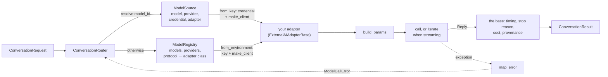

# Your own models, providers and adapters

How to use your own models and providers with framekit without changing framekit. The usual way is a **`ModelSource`**: one structure that names the model, where it's served, its credential and, when the provider speaks a protocol framekit doesn't know, your **adapter** written from the template. A **model registry** is the lower-level container underneath. Decided 2026-10-24 ([DECISIONS](DECISIONS.md)).

**Contents:** [Do you need an adapter?](#do-you-need-an-adapter) · [ModelSource: one structure](#modelsource-one-structure) · [Config only: an OpenAI-compatible server](#config-only-an-openai-compatible-server) · [The template](#the-template) · [The registry](#the-registry) · [Errors](#errors) · [Keys and keyless servers](#keys-and-keyless-servers) · [Streaming](#streaming) · [Provenance and the response cache](#provenance-and-the-response-cache) · [Security](#security) · [Public API and versions](#public-api-and-versions)



---

## Do you need an adapter?

Often not. A provider is plain data (`ProviderConfig`), and so is a model (`ModelSpec`); an adapter is code, needed only for a wire protocol framekit doesn't speak.

| Your provider | What you write |
|---|---|
| Any server that speaks OpenAI **Chat Completions**: a hosted provider, a self-hosted **vLLM** server, **Ollama**'s OpenAI-compatible endpoint (`/v1`), a gateway in front of them | config only: a `ProviderConfig` with `protocol="openai"` and its `base_url`, plus your `ModelSpec`s, in a registry ([below](#config-only-an-openai-compatible-server)) |
| **Claude on Amazon Bedrock** | possibly config only, **not verified**: see [the note below](#claude-on-amazon-bedrock-unverified) |
| Another protocol or client library: an in-house gateway, a provider with its own SDK, a different way to authenticate | an adapter ([the template](#the-template)) plus config |

**Probe before you rely on a provider.** "Compatible" servers differ in the details framekit records: how reasoning is switched on and off, which structured-output method works, whether token usage arrives in a stream, which stop reasons and error statuses they send. Run a few short, cheap calls, then write what you measured into the `ModelSpec` (the built-in catalog in `framekit/models/catalog.py` records its probes the same way, in comments). Until you have probed:
- leave `reasoning=None` (no switch is sent) and `structured_method="prompted"` (the schema goes into the instructions only);
- keep `stream=False` on the `ProviderConfig` (the default): framekit's streaming path takes token usage from the stream itself, and some servers include it there only when asked to. `router.stream(...)` still works without it.

## ModelSource: one structure

A `ModelSource` answers four questions in one place: which model, where it's served, with which key, and through which adapter. Pass sources to the router; requests (`ConversationRequest.model_id`) and `ModelSettings.default_model` refer to a source by its name.

```python
import os
from decimal import Decimal

from pydantic import SecretStr

from framekit.models import ConversationRouter, ModelSettings, ModelSource, ModelSpec, ProviderConfig

sources = [
    # a built-in catalog model, with your own key instead of ANTHROPIC_API_KEY
    ModelSource("claude", model="claude-haiku-4-5",
                credential=SecretStr(os.environ["MY_CLAUDE_KEY"])),
    # a self-hosted model: your model description, your server, no key
    ModelSource("local", model=ModelSpec("box", "qwen3-32b", "Qwen3 32B on vLLM",
                                         Decimal(0), Decimal(0)),
                provider=ProviderConfig("box", "openai", base_url="http://127.0.0.1:8000/v1")),
    # your own adapter (the template below), with a token fetched for each unit of work
    ModelSource("inhouse", model=IN_HOUSE, provider=GATEWAY, adapter=GatewayAdapter,
                credential=lambda: vault.read("gateway")),
]
router = ConversationRouter(ModelSettings(default_model="claude"), sources=sources)
```

| Field | Meaning | If omitted |
|---|---|---|
| `name` | what requests and plan roles refer to | required |
| `model` | a model id from the router's registry (e.g. a built-in catalog model), or your own `ModelSpec`; its `model_id` is what's sent to the provider | required |
| `provider` | where it's served: a `ProviderConfig`, or the name of a provider in the registry. It wins over the spec's own `provider` field | the model's own provider |
| `credential` | a string, a pydantic `SecretStr`, or a callable returning one (called once per router, so rotating tokens and secret managers work) | the provider's `key_env` variable; no key for a provider without one |
| `adapter` | your adapter class ([the template](#the-template)) | the registry's adapter for the provider's protocol |

- **Built-ins keep working.** Anything that isn't a source's name is resolved by the router's registry, so `model_id="claude-haiku-4-5"` and the environment keys work as before. A source that reuses a catalog id overrides that model, for this router only.
- **Checked when the router is built.** Unknown models or providers, a protocol without an adapter, an adapter class that can't work, an empty credential and duplicate names are all reported at once, in one `ValueError`.
- **An adapter class, not an instance.** The router builds a fresh adapter (and client) per unit of work and closes it at the end; a shared instance would be closed under its other users.
- **Credentials are never recorded.** A string credential is stored as a `SecretStr` (hidden in reprs and logs) and goes only to the adapter's `make_client` (through `from_key`). Results record the source's name (`result.source`), cache keys its public fingerprint, never the key. A source holding a credential refuses to be pickled: give worker processes their keys through their own environment or secret store.
- **What a source doesn't hold:** settings per use (`max_tokens`, temperature, reasoning) stay on the request, since one source can serve several roles; router-wide limits stay in `ModelSettings`.

## Config only: an OpenAI-compatible server

```python
from decimal import Decimal

from framekit.contracts import ConversationRequest
from framekit.models import ConversationRouter, ModelSettings, ModelSource, ModelSpec, ProviderConfig

LOCAL = ProviderConfig(
    name="local",
    protocol="openai",                    # served by the built-in OpenAI-compatible adapter
    base_url="http://127.0.0.1:8000/v1",  # vLLM's default; Ollama: http://127.0.0.1:11434/v1
    # key_env omitted (None): the server takes no key. For one that does, name the
    # variable holding it, e.g. key_env="LOCAL_LLM_KEY", and use https for any host but
    # this machine: over http:// the key travels in clear text.
)
MY_MODEL = ModelSpec(
    provider="local",
    model_id="my-local-model",            # the name the server knows the model by
    label="My local model",
    input_usd_per_mtok=Decimal("0"),
    output_usd_per_mtok=Decimal("0"),
)
sources = [ModelSource("local", model=MY_MODEL, provider=LOCAL)]

async with ConversationRouter(ModelSettings(default_model="local"), sources=sources) as router:
    result = await router.generate(ConversationRequest("Say hello.", max_tokens=50))
```

The built-in models stay available next to your sources.

### Claude on Amazon Bedrock (unverified)

Bedrock serves Claude through the Anthropic Messages API on its "Mantle" endpoint, `https://bedrock-mantle.<region>.api.aws/anthropic`, where model IDs carry an `anthropic.` prefix. So a `ProviderConfig(protocol="anthropic", base_url=..., key_env=...)` whose variable holds a Bedrock API key *may* work as config only, but **nobody has probed it**, and there's a concrete reason it may not: framekit's Anthropic adapter sends the key in the `x-api-key` header, while the `anthropic` SDK's own Bedrock client (`AsyncAnthropicBedrockMantle`) sends a Bedrock API key as `Authorization: Bearer`. If the config route is rejected, an adapter whose `make_client` builds the SDK's Bedrock client is the way. In practice that's a subclass of the built-in `AnthropicAdapter` (`framekit.models.adapters.anthropic`) that overrides only `make_client`, to reuse its Messages requests and reply parsing. That class is internal, not covered by semantic versioning ([Public API and versions](#public-api-and-versions)), so its internals may change in any release: pin the framekit version you probed, and probe again when you upgrade. Probe it before relying on it either way, and check which features Bedrock supports for your model.

## The template

An adapter subclasses `ExternalAIAdapterBase` from `framekit.models.adapters`. This complete example runs as is: the gateway client is a stand-in, so no server is needed.

```python
import asyncio
from decimal import Decimal
from typing import Any, ClassVar

from framekit.contracts import ConversationRequest, ModelCallError, TextDelta
from framekit.models import (
    DEFAULT_REGISTRY,
    ConversationRouter,
    ModelSettings,
    ModelSpec,
    ProviderConfig,
)
from framekit.models.adapters import (
    ExternalAIAdapterBase,
    Reply,
    conversation,
    merge_fields,
    reasoning_active,
    reasoning_fields,
    structured_mode,
    system_text,
)


# --- your gateway's client (a stand-in here, so the example runs as is) ------------------
class GatewayError(Exception):
    def __init__(self, status: int, message: str) -> None:
        super().__init__(message)
        self.status = status


class GatewayClient:
    def __init__(self, api_key: str, base_url: str | None, timeout_s: float) -> None:
        self.api_key, self.base_url, self.timeout_s = api_key, base_url, timeout_s

    async def complete(self, payload: dict[str, Any]) -> dict[str, Any]:
        prompt = payload["messages"][-1]["content"]
        if prompt == "fail":
            raise GatewayError(503, "gateway overloaded")
        usage = {"in": 7, "out": 3}
        return {"text": f"echo: {prompt}", "finish": "stop", "usage": usage, "id": "gw-1"}

    async def close(self) -> None:
        pass


# --- the adapter ---------------------------------------------------------------------------
class GatewayAdapter(ExternalAIAdapterBase):
    adapter_version: ClassVar[str] = "gateway-0.1.0"  # bump when requests or parsing change

    @classmethod
    def make_client(cls, api_key: str, base_url: str | None, timeout_s: float) -> Any:
        return GatewayClient(api_key, base_url, timeout_s)

    def build_params(
        self, spec: ModelSpec, request: ConversationRequest, max_tokens: int
    ) -> dict[str, Any]:
        system = system_text(request, structured_mode(spec, request, self.structured_modes))
        messages = conversation(request)
        if system:
            messages = [{"role": "system", "content": system}, *messages]
        return merge_fields(
            {"model": spec.model_id, "messages": messages, "max_tokens": max_tokens},
            spec.request_extras,
            reasoning_fields(spec, reasoning_active(spec, request)),
        )

    async def call(self, spec: ModelSpec, params: dict[str, Any]) -> Reply:
        data = await self.client.complete(params)
        return Reply(
            text=data["text"],
            stop_reason=data["finish"],
            input_tokens=data["usage"]["in"],
            output_tokens=data["usage"]["out"],
            request_id=data["id"],
        )

    def map_error(self, exc: Exception) -> ModelCallError | None:
        if isinstance(exc, GatewayError):
            retryable = exc.status == 429 or exc.status >= 500
            return ModelCallError(f"gateway {exc.status}: {exc}", retryable=retryable)
        return super().map_error(exc)


# --- register it ---------------------------------------------------------------------------
GATEWAY = ProviderConfig(
    name="my-gateway",
    protocol="my-gateway",  # any name: the registry maps it to an adapter class
    key_env=None,  # the variable holding its key, e.g. "MY_GATEWAY_KEY"; None: no key
    base_url="https://llm.internal.example/v1",
)
IN_HOUSE = ModelSpec(
    provider="my-gateway",
    model_id="inhouse/llm-1",
    label="In-house LLM",
    input_usd_per_mtok=Decimal("0"),  # prices only feed result.cost_usd (an estimate)
    output_usd_per_mtok=Decimal("0"),
)
registry = DEFAULT_REGISTRY.extend(
    providers=[GATEWAY], models=[IN_HOUSE], adapters={"my-gateway": GatewayAdapter}
)


async def main() -> None:
    settings = ModelSettings(default_model="inhouse/llm-1", max_tokens_cap=512)
    async with ConversationRouter(settings, registry=registry) as router:
        result = await router.generate(ConversationRequest("hello", max_tokens=50))
        print(result.text, "|", result.provider, result.model_id, result.adapter_version)

        async for piece in router.stream(ConversationRequest("stream me", max_tokens=50)):
            print(piece.text if isinstance(piece, TextDelta) else f"[{piece.stop_reason}]")

        try:
            await router.generate(ConversationRequest("fail", max_tokens=50))
        except ModelCallError as error:
            print(error, "| retryable:", error.retryable)
    print(len(registry.listing()), "models: the built-ins plus yours")


asyncio.run(main())
```

The same model as a source, with no registry: `ConversationRouter(settings, sources=[ModelSource("inhouse", model=IN_HOUSE, provider=GATEWAY, adapter=GatewayAdapter)])`, with `default_model="inhouse"`.

It prints:

```text
echo: hello | my-gateway inhouse/llm-1 gateway-0.1.0
echo: stream me
[end]
gateway 503: gateway overloaded | retryable: True
7 models: the built-ins plus yours
```

### What you implement

| Member | | What it does |
|---|---|---|
| `adapter_version` | **required** | a non-empty string recorded in every result; bump it whenever the requests you send or the way you read replies change. Without one, building the adapter raises `TypeError` (before any call) |
| `build_params(spec, request, max_tokens)` | **required** | the request for one call, as a dict. `max_tokens` is the budget to send: the base has already applied the output cap and the reasoning allowance |
| `call(spec, params)` | **required** | send the request, parse the response into a `Reply` (text, reasoning, raw stop reason, token counts, request id, the model that answered) |
| `make_client(api_key, base_url, timeout_s)` | optional, **a classmethod** | build your client. Lets `from_environment`, and so a registry, build the adapter from its `ProviderConfig`. Without it, build the adapter yourself, `GatewayAdapter(config, client, settings)`, in an `adapter_factory` ([below](#adapters-built-by-hand)) |
| `iterate(spec, params)` | optional | real streaming ([below](#streaming)) |
| `map_error(exc)` | optional | translate your client's exceptions ([below](#errors)) |
| `aclose()` | optional | release the client. The default calls the client's `aclose()` (an `httpx` client, say) or else its `close()`, and awaits the result when it's awaitable |
| `structured_modes` | optional | the structured-output methods your `build_params` applies; for any other method the base falls back to `"prompted"` (default: only `"prompted"`) |
| `sdk` | optional | an `openai`/`anthropic`-style SDK module, whose errors the base then maps ([below](#errors)); default `None` |

Inside your methods, `self.client` is the client, `self.config` the `ProviderConfig`. Your `__init__` may assign `self.client`: that replaces the client the adapter uses and closes.

### What the base does for you

- **The output budget:** the request's `max_tokens`, capped by `ModelSettings.max_tokens_cap`, plus the model's reasoning allowance while reasoning is on.
- **Reasoning switches:** whether this call reasons (`reasoning_active`) and the fields that switch it (`reasoning_fields`, from the model's `ReasoningControl`).
- **Timing:** `latency_ms`, and `first_token_ms` when streaming.
- **Stop reasons:** your raw value normalized to `end`, `length`, `refusal`, `tool_use`, `content_filter` or `other`; a reply that used the whole budget is reported as `length`, whatever the provider says.
- **Cost:** `cost_usd` estimated from the `ModelSpec`'s prices and the token counts.
- **The result:** one `ConversationResult` with its provenance (provider, model, adapter version, request id), from both `generate` and `stream`.
- **Streaming fallback, the response cache and closing:** `router.stream` works even if you never stream; the response cache works unchanged; the router closes your adapter with the others.

What it doesn't do: translate your client's exceptions. Unless you set `sdk`, that's yours ([Errors](#errors)).

The helpers you see in the example (`conversation`, `system_text`, `structured_mode`, `reasoning_active`, `reasoning_fields`, `merge_fields`, plus `output_budget`, `normalize_stop_reason` and `map_sdk_error`) are the ones the built-in adapters use.

## The registry

The lower-level container; sources are usually enough. A `ModelRegistry` holds providers (by name), models (by `model_id`) and adapter classes (by protocol). The router resolves everything that isn't a source through it, and checks sources against it.

```python
from framekit.models import DEFAULT_REGISTRY, ConversationRouter, ModelRegistry

# GATEWAY, IN_HOUSE and GatewayAdapter are from the template above.
mine = DEFAULT_REGISTRY.extend(  # the built-ins plus yours
    providers=[GATEWAY], models=[IN_HOUSE], adapters={"my-gateway": GatewayAdapter}
)
only_mine = ModelRegistry(  # yours alone
    providers=[GATEWAY], models=[IN_HOUSE], adapters={"my-gateway": GatewayAdapter}
)

router = ConversationRouter(settings, registry=mine)
```

- **Checked when built.** All problems are reported at once, in one `ValueError`:
  - `providers` and `models` are lists (or other iterables) of `ProviderConfig`s and `ModelSpec`s, and `adapters` is a mapping of protocol names to adapter classes;
  - names are non-empty strings (a provider's `name` and `protocol`, a model's `model_id` and `provider`, the protocol names), `key_env` is `None` or a variable's name, and prices are `Decimal`s (a float would only fail after the call, when the cost is computed);
  - every model's provider is configured, and every provider's protocol has an adapter;
  - every adapter class can work: it implements `build_params` and `call`, sets `adapter_version`, and its `make_client` and `from_environment` are classmethods.

  Not checked: whether an adapter class implements `make_client` at all. One without it is accepted, because a router with an `adapter_factory` only uses the registry to resolve models ([below](#adapters-built-by-hand)); `registry.create_adapter` then raises `NotImplementedError` for it. Nor, of course, whether your provider accepts the values in your config: probe it.
- **No silent replacement.** `extend` refuses a name the registry already has (a provider, a model or a protocol) unless you pass `override=True`. The same name twice in one call is always an error.
- **Immutable (shallowly) and isolated.** `extend` returns a new registry and leaves the old one unchanged, and a registry's mappings can't be changed. A model you add to one registry is invisible to the default router and to every other registry. The entries themselves are shared, with the built-ins and between registries, and some hold dicts (`ProviderConfig.extra_headers`, `ModelSpec.request_extras`, `ReasoningControl.on` and `off`): **never mutate an entry in place**, since that changes it for every registry and router in the process. Replace it instead: `DEFAULT_REGISTRY.extend(providers=[dataclasses.replace(PROVIDERS["hive"], base_url=...)], override=True)`.
- **Lookups:** `registry.resolve(model_id)` and `registry.create_adapter(provider, settings)`; an unknown model, provider or protocol, or a missing key, is a non-retryable `ModelCallError`. `registry.listing(default_model)` gives the rows for a model picker (no prices).
- **Pickling:** a registry can be pickled, e.g. for worker processes. `DEFAULT_REGISTRY` goes by reference, so in the receiving process it's that process's own built-ins; any other registry goes by value, with its adapter classes by reference (define them at module level, so the worker can import them).
- **The built-in dicts** (`CATALOG`, `PROVIDERS`, `PROTOCOLS`) are what `DEFAULT_REGISTRY` serves, and it reads them live, so code that edits them in place still reaches the default router. That is **unsupported**: it changes every router in the process. Use `extend`. An extended registry is a snapshot, so later in-place edits don't reach it either. Rebinding the names (`router.CATALOG = {...}`, or `monkeypatch.setattr` on them) reaches no router at all, since `DEFAULT_REGISTRY` holds the dicts themselves. `framekit.models.router` still re-exports the names it had before registries existed (`CATALOG`, `PROVIDERS`, `PROTOCOLS`, `ModelCallError` and the built-in adapter classes), so old imports keep working.

### Adapters built by hand

`ConversationRouter(settings, adapter_factory, registry=...)`: the factory builds the adapters, and the registry only resolves the models. This is for tests, and for an adapter without `make_client`. The router calls the factory once for **every provider** it uses, built-in ones included, so build yours and hand every other provider to the registry:

```python
def factory(provider: str, settings: ModelSettings):
    if provider == GATEWAY.name:  # yours, built by hand
        client = connect_to_gateway(settings.timeout_s)  # however your client is made
        return GatewayAdapter(GATEWAY, client, settings)
    return registry.create_adapter(provider, settings)  # every other provider

async with ConversationRouter(settings, factory, registry=registry) as router:
    ...
```

Use the registry's `create_adapter`, not the module-level `framekit.models.create_adapter`: that one serves only the built-ins, so your registry's other providers would fail with "no provider configured". A factory that ignores `provider` would serve every model through your adapter, with the wrong provider in the results.

## Errors

Every failure a caller sees should be a `ModelCallError`, with `retryable` saying whether trying again can help (rate limits, timeouts, 5xx: yes; bad requests, auth, no balance: no). You have three ways to get there:

1. **Raise `ModelCallError` yourself** in `call` or `iterate`. The base always lets it through unchanged, the same object: `map_error` never sees it.
2. **Override `map_error(exc)`**: return a `ModelCallError` for your client's exceptions, and `super().map_error(exc)` for the rest (the example above). The base raises what you return, chained to the original (`raise ... from exc`); `None`, or `exc` itself, lets the exception propagate unchanged. Returning anything else is a bug in the adapter: the base raises a `TypeError` that names your `map_error`, chained to the original exception.
3. **Set `sdk`** to a module shaped like the `openai` and `anthropic` SDKs. The base then maps its `APIError`s with `map_sdk_error`, which expects those SDKs' exception names (`AuthenticationError`, `RateLimitError`, `APIStatusError`, `APIConnectionError`, …). Only for adapters built on such an SDK.

Anything else (an exception `map_error` returns `None` for) propagates unchanged: it's a bug in the adapter, and should surface as one. With `sdk=None`, the default, no exception is translated.

## Keys and keyless servers

Where a key comes from, in order: the source's `credential` (passed to `from_key`); else the variable `ProviderConfig.key_env` names (`from_environment` reads it, then calls `from_key`); else, for a provider without a key, the placeholder below. Override `from_key`, not `from_environment`, to build your client another way: both paths go through it.

`from_environment` reads the key from the variable `ProviderConfig.key_env` names. A missing key fails only that provider's requests, with a non-retryable `ModelCallError` that names the variable.

For a server that takes no key, leave `key_env` as `None`. Your `make_client` then gets `PLACEHOLDER_KEY` (`"framekit-no-key"`), **never `None`**: given no key, the `openai` and `anthropic` SDKs fall back to their own environment variables (`OPENAI_API_KEY`, `ANTHROPIC_API_KEY`, `ANTHROPIC_AUTH_TOKEN`, …) and would send a real cloud key to your server. If your own client does something similar, make sure the placeholder reaches it.

## Streaming

`router.stream(...)` works with every adapter. By default the base makes one `call`, then yields its reasoning and its text as single pieces and the final result, so the caller gets the whole answer at once (`first_token_ms` is then the time of the whole call).

For real streaming, override `iterate`: yield `TextDelta("text", ...)` and `TextDelta("reasoning", ...)` pieces as they arrive, then exactly one final `Reply`. A sketch, for a client with its own streaming call:

```python
    async def iterate(self, spec, params):
        stream = await self.client.stream(params)  # your client's streaming call
        reply, parts = Reply(), []
        try:
            async for event in stream:
                if event.text:
                    parts.append(event.text)
                    yield TextDelta("text", event.text)
                if event.usage:  # often only in the last event
                    reply.input_tokens, reply.output_tokens = event.usage.input, event.usage.output
                reply.stop_reason = event.finish or reply.stop_reason
        finally:
            await stream.close()  # also when the caller stops reading early
        reply.text = "".join(parts)
        yield reply
```

`generate` still uses `call`. If your provider only streams, let `call` consume `iterate` and return its final `Reply` (the built-in OpenAI-compatible adapter does this for Hive).

## Provenance and the response cache

- **What a result records:** `provider` is your `ProviderConfig.name`; `adapter_version` is your class's; `model_id` is the model that answered (`Reply.model_id`) or, when the reply doesn't say, the one requested; `cost_usd` is an estimate from your `ModelSpec` prices (use `0` for servers you don't pay per token). Record these with every output.
- **`result.source`** names the `ModelSource` that served the call (`None` for a registry model).
- **The response cache** keys a **source** by its model id plus a public fingerprint: the protocol, the base URL, the adapter class and its `adapter_version`. So two sources serving the same model id from different hosts never share cached answers, and bumping an adapter's version starts fresh entries. Sources that differ only in name or credential share entries (same model, same place).
- **Registry models** keep their plain model id in the cache key, unchanged: the key covers everything in the request that shapes a reply, but **not** the provider, the host or the adapter version. So:
  - if two registries map the same `model_id` to different hosts (say, a local copy and a hosted one), keep their caches apart with different `CacheSettings.namespace` values, or use sources;
  - bumping `adapter_version` doesn't invalidate a registry model's recorded replies; change the namespace for that too.

## Security

- **Only point a provider at a host you trust.** framekit sends the provider's key (from `key_env`) to the provider's `base_url` with every request. If the provider has a `base_url_env`, whoever sets that variable chooses where the key goes.
- **Give every provider you add an explicit `base_url`.** With `base_url=None` the SDK chooses the host: its default (OpenAI's or Anthropic's API), or `OPENAI_BASE_URL` / `ANTHROPIC_BASE_URL` from the environment.
- **Known gap: SDK environment variables reach custom hosts too.** The official SDKs read some settings from the environment by themselves and send them with every request, to whatever host the client points at: `OPENAI_CUSTOM_HEADERS` and `ANTHROPIC_CUSTOM_HEADERS` (arbitrary headers, which can carry credentials), and `OPENAI_ORG_ID` / `OPENAI_PROJECT_ID`. framekit doesn't strip them yet; this is a known gap, to be closed later. Until then, don't set these variables in a process that talks to a host you don't fully trust.
- **Known gap: nothing binds a key to a host yet.** A provider config may name any key variable, including the built-in providers' (`ANTHROPIC_API_KEY`, …), and framekit sends that key to the config's own `base_url`. A `ModelSource` puts the credential and the provider side by side, so the pairing is visible in one place, but framekit doesn't restrict it. Review provider configs and sources you didn't write as you would code.
- **Credentials stay out of records.** A source's credential is a `SecretStr`, never written to results, cache keys, fingerprints or manifests, and a source holding one refuses to be pickled.
- **Known gap: framekit doesn't check the URL scheme.** Use `https` for every host that isn't on the same machine (`127.0.0.1`, `localhost`): with an `http://` `base_url`, the key travels in clear text.
- **Keyless servers get a placeholder**, never nothing ([above](#keys-and-keyless-servers)), so the SDKs can't fall back to a cloud key.
- **An adapter handles your keys.** Review one (yours or someone else's) like any code that holds credentials. framekit's own adapters depend only on the official provider SDKs; the dependency choices for yours are yours.

## Public API and versions

`ExternalAIAdapterBase`, `Reply`, `PLACEHOLDER_KEY` and the helpers exported from `framekit.models.adapters` (its `__all__`), together with `ModelSource`, `ModelRegistry` and `DEFAULT_REGISTRY` from `framekit.models` (and `ExternalAIAdapterBase.from_key`), are public API under semantic versioning: an incompatible change to them is a new minor version while framekit is 0.x, and a new major version after that. Other names in the adapter modules are internal. That includes the built-in adapter classes (`OpenAICompatibleAdapter`, `AnthropicAdapter`), even though `DEFAULT_REGISTRY.adapters` hands them out: subclassing one relies on internals that may change in any release.

To test an adapter, give it a fake client with the same shape, as framekit's own tests do (`tests/test_custom_adapters.py`).
