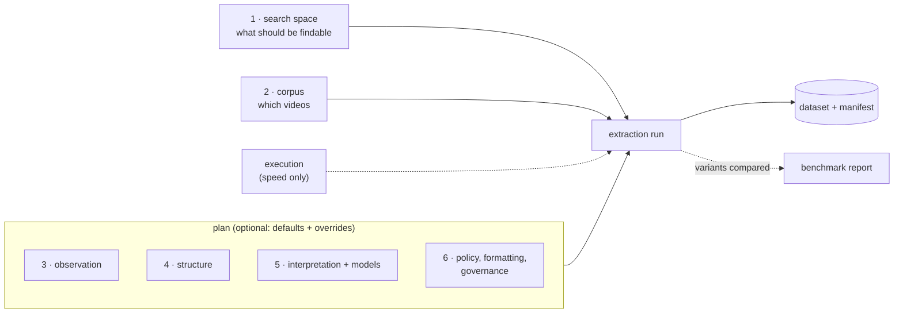

# Extraction Settings: Full Reference

Every setting that shapes an extraction run, in one place: what you give, what framekit decides, what comes out. It's the spec for the schemas built in milestone E1 (`SearchSpace`, `Corpus`, `ExtractionPlan`, `GoldSet`). Why it's shaped this way: [DESIGN.md](DESIGN.md) §2.3–§2.4; decisions: [DECISIONS.md](DECISIONS.md).

> **Status:** in progress on `main` (2026-10-24), after v0.1.0. Built: model access (`ModelSettings`, `CacheSettings`, per-request options), the vision parameters (§5.2: schema, checks, resolution, pixel-free planning), lens specs (§3.1), and the schemas of the search space, corpus, plan and gold set (§3–§6): every setting below is parsed and checked. What a setting does takes effect when its stage is built (milestone E1: resolution, media work, runs, benchmarks); until then, its description is the design.

**Tags:** **[built]** in code (v0.1.0, or on `main` since) · **[not built]** accepted or refused with a clear reason, but not implemented yet · **[designed]** in DESIGN.md / ARCHITECTURE.md · **[discussed]** agreed with the owner, first written down here · **[open]** value or choice not decided · **[fixed]** a rule, not a setting. **Every number is a placeholder** until a benchmark sweep sets it.

---

## 1. High level: six questions

An extraction run is described by the answers to six questions, plus how it runs.

| Question | Called | What it decides |
|---|---|---|
| **1. What should people be able to find?** | search space | the topics (lenses), how short a moment can be, which parts of the videos count, how people will phrase searches |
| **2. Which videos?** | corpus | the files (pointed to, never copied), which edition, metadata, the entities to recognize, usage rights |
| **3. How is the video looked at?** | observation | the analysis copy; cheap signals (cuts, sounds, speech, motion); which frames each model sees; long videos in chunks |
| **4. What is one data point?** | structure | scenes, beats inside them, or fixed time windows |
| **5. What is written about each data point, and by which models?** | interpretation, models | observable facts → lens labels and query-like phrasings → vectors; one model per role |
| **6. What rules apply?** | policy, formatting, governance | quality checks, budget, table format, what may leave the machine |
| *How does it run?* | execution | parallelism, rate limits, cache, folders; never changes the result |



The same run in plain words (the test corpus, Appendix A of DESIGN.md):

```
Extraction run: emotional moments, test corpus (5 units)
├─ Find      lenses: emotions & dynamics, comedy craft · moments of 3–6 s
│            all units, skipping title cards · queries like "my team keeps arguing…"
├─ Videos    the user's own copies on D:/media/tj · bring-your-own rights
├─ Look      720p analysis copy · cuts, sound peaks, speech, motion
│            whole unit at 1 fps to find scenes · up to 16 frames per scene for facts
├─ Cut into  scenes of 30–60 s snapped to cuts · beats inside (optionally 3 s windows)
├─ Describe  facts per scene → lens labels + 8 phrasings → text and image vectors
│            models: one per role (to be chosen)
├─ Rules     problems are flagged, never silently dropped · $25 cap · Parquet tables
│            image vectors and training stay local
└─ Run       8 in parallel · model-call cache on · resumes automatically
→ dataset + manifest
```

**How the answers are recorded:**

| Group | In the manifest | In the stage input hash | Changing it means |
|---|---|---|---|
| Search space | verbatim, with its hash | yes, per affected stage | a different search space: new versions of affected rows |
| Corpus | yes (units, releases, alignment) | yes, per unit | a different dataset for those units |
| Plan: observation, structure, interpretation, models | fully resolved | yes, per affected stage | new versions of affected rows |
| Plan: quality control | yes | yes (it decides flags and retries) | same values, different flags |
| Plan: formatting | yes | `schema_version` and `tables`: yes; `layout`: no | layout changes rewrite files without model calls |
| Plan: budget | yes | no | only whether and when the run completes |
| Plan: governance | yes | no; **enforced**, never overridden | what may leave the machine, never what's computed |
| Execution | logged only | no | the same dataset, faster or slower |

---

## 2. Commands

```bash
framekit extract \
  --space    search-space.yaml \                  # 1. what should be findable     [designed]
  --corpus   corpus.yaml \                        # 2. which videos                [designed]
  --plan     plan.yaml \                          # 3–6. how (optional)            [discussed flag]
  --out      ~/framekit-data/datasets/tj-emotions-v1 \                          # [designed]
  --work-dir ~/framekit-data/work \               # video copies: outside any repo [discussed]
  --concurrency 8 \                                                             # [discussed]
  --rate-limit hive=4/s --rate-limit anthropic=2/s \                            # [discussed]
  --provider-retries 3 \                          # transport errors only          [discussed]
  --cache-dir ~/framekit-data/model-cache \                                     # [discussed]
  --cache-mode record --cache-mode L3b=replay \   # default, then per call class   [built: CacheSettings.classes]
  --dry-run                                       # validate + cost estimate, no spend [discussed]
# Runs always resume: tasks are keyed by their inputs and finished ones are skipped.
# --rerun L3b forces one stage again (ignores its existing run records).        [discussed]

framekit bench --corpus corpus.yaml --plan plan.yaml \       # compare search spaces,
  --space raw=space-raw.yaml --space llm=space-llm.yaml \    # plan pinned       [designed]
  --gold gold/queries.yaml --scorer baseline_retriever --out reports/aug-1
framekit bench --corpus corpus.yaml --space search-space.yaml \   # compare plans,
  --plan v8=plan-8f.yaml --plan v16=plan-16f.yaml \               # space pinned   [designed]
  --gold gold/queries.yaml --out reports/frames-1

framekit cache stats --cache-dir ~/framekit-data/model-cache     # [designed]
framekit cache wipe  --cache-dir ~/framekit-data/model-cache [--class L3b]
```

The default folders live outside the project on purpose: the work directory holds normalized copies and chunk files, which count as footage for a bring-your-own corpus, so they must never land in a repository. framekit also writes a `.gitignore` containing `*` into every folder it creates. [discussed]

**Python** (designed for E1; the cache classes are built):

```python
from framekit.extraction import SearchSpace, Corpus, ExtractionPlan, GoldSet   # [built]
from framekit.extraction import extract, benchmark, baseline_retriever, Dataset, LocalRunner
from framekit.models.cache import FileResponseStore, CacheSettings, ClassPolicy   # [built]

dataset = extract(
    SearchSpace.load("search-space.yaml"),
    Corpus.load("corpus.yaml"),
    plan=ExtractionPlan.load("plan.yaml"),                    # None: defaults + derivation rules
    runner=LocalRunner(concurrency=8, rate_limits={"hive": 4.0}, provider_retries=3,
                       work_dir="~/framekit-data/work"),
    out="~/framekit-data/datasets/tj-emotions-v1",
    cache=FileResponseStore("~/framekit-data/model-cache"),
    cache_settings=CacheSettings(mode="record", classes={"L3b": ClassPolicy(mode="replay")}),
    dry_run=False,
)
again = Dataset.open("~/framekit-data/datasets/tj-emotions-v1")   # typed readers + .manifest

report = benchmark(
    {"raw": SearchSpace.load("space-raw.yaml"), "llm": SearchSpace.load("space-llm.yaml")},
    Corpus.load("corpus.yaml"),
    plan=ExtractionPlan.load("plan.yaml"),                    # pinned for the comparison
    gold=GoldSet.load("gold/queries.yaml"),
    scorer=baseline_retriever,                                # or any score(dataset, gold)
)
```

---

## 3. Search space: `search-space.yaml`

What should become findable. It's **given input**: written by hand or produced by an augmentation strategy, and framekit never edits it (DESIGN.md §2.4). Its digest (`SearchSpace.digest`) covers the file as given and every lens spec it names.

```yaml
search_space:
  version: 1
  intent: >                                        # [built] opaque text
    Moments whose emotional and interpersonal structure mirrors a real-life situation.
  lenses:                                          # [built] the searchable dimensions
    - {spec: lenses/emotions_dynamics, version: 1.0.0}   # a folder or file, relative to this file
    - {spec: lenses/comedy_craft, version: 0.1.0}        # the spec's version must match
  evidence:                                        # [built] optional, taken as given;
    modules: [sound]                               #   the lenses' own needs are added in the plan
  resolution:                                      # [built] how fine a match can be
    moment_length_s: {min: 3, max: 6}
  scope:                                           # [built] can only narrow the corpus
    units: {include: all, exclude: []}             #   unknown ids are errors
    excluded_ranges: from_corpus                   #   from_corpus | none
  query_style:                                     # [built] how searches will be phrased
    examples:                                      #   must not repeat a gold query (§6)
      - "my team keeps arguing about the same thing"
      - "planning something perfect that goes wrong"
```

### 3.1 Lens specs: `lens.yaml` [built]

A lens is a spec file (YAML or JSON), or a folder holding `lens.yaml`, `lens.yml` or `lens.json`, plus prompt files. Decided as built (v1, DECISIONS 2026-10-24). In code: `LensSpec.load(path)`, `LensSpec.from_mapping(data)`.

```yaml
lens:
  name: emotions_dynamics                # lower snake case
  version: 1.0.0                         # 1, 1.0 or 1.0.0
  description: Emotional and interpersonal structure.
  example_queries: ["every fix I push breaks something else"]   # carried for consumers
  requires_modules: [sound]              # perception modules beyond core
  targets: [scene, beat]                 # what gets annotations (default: both)
  fields:                                # the output schema; labels are fixed vocabularies
    dynamics: {type: labels, vocabulary: [futile_effort, backfire, escalation], max: 3}
    outcome:  {type: label, vocabulary: [schemer_wins, schemer_loses, draw], optional: true}
    feelings:                            # a map keyed by the corpus profile's entities
      type: map
      keys: entities
      extra_keys: [viewer]
      values:
        type: list
        max: 3
        items:
          type: object
          fields:
            label: {type: label, vocabulary: [frustration, smugness, schadenfreude]}
            intensity: {type: integer, min: 1, max: 5}
  prompts:
    interpretation: {file: prompts/interpret.md}   # or inline text; files stay in this folder
    phrasing: "Real-life situations the moment could describe."
    phrasing_style: "first person, everyday words"   # used when the space has no examples
  validators:                            # checked in L4
    - {kind: required, fields: [dynamics]}
    - {kind: exclusive, field: dynamics, labels: [backfire, futile_effort]}
  gold: gold/annotations.yaml            # carried for benchmarks
  consumer: {...}                        # carried verbatim for consumers; never read here
```

- **Field types:** `label` (one value of `vocabulary`), `labels` (several, unique; `min`/`max` count them), `integer` and `number` (`min`/`max` bound the value), `boolean`, `object` (`fields`), `list` (`items`; `min`/`max` count them), `map` (`keys: entities`, the corpus profile's names plus `extra_keys`, or `keys: vocabulary`; `values` for each). Any field may be `optional`. There's **no free-text type**, and vocabulary labels are lower snake case.
- **Checked at load, every problem at once:** settings that don't belong to a type, missing vocabularies or parts, duplicate labels, `min` above `max`, validators naming unknown fields or labels, prompt files outside the spec's folder.
- **What the model gets:** the fields compiled into a JSON Schema (`scene`, `beats` by index, `phrasings`); every reply is checked against the fields, the vocabularies, the beat indexes and the phrasing count, whatever the provider enforced.
- **Digest:** the spec's canonical form, prompts included; it's part of the search space's digest and of every lens pass's input hash.

---

## 4. Corpus: `corpus.yaml`

Which videos. It points to files and never copies or modifies them (DESIGN.md §1, §8.2).

```yaml
corpus:
  profile:                                         # [built] the corpus profile template
    name: tom_and_jerry
    unit_definition: "one complete theatrical short per file; never a TV episode"
    metadata_fields:                               # str | int | float | bool, or allowed values
      title: str
      year: int
      era: [hanna_barbera, deitch, jones]
      runtime_s: float
      release_source: str
      source_quality: str
    entities: [Tom, Jerry, Spike, Tyke, Butch, Nibbles, Toodles]
    perception_hints:                              # [built] sent to L2 and L3a as context
      - "almost dialogue-free; the soundtrack carries meaning"
      - "animation smear frames inflate shot-cut counts"
    rights_mode: byo_media                         # [built] byo_media | hosted | embed
  subset: [tj042]                                  # [built] units this run may process (default:
                                                   #   all); the search space's scope narrows further
  manifest:                                        # [built]
    - unit_id: tj042
      expected_duration_s: 412.3
      fingerprint: "chromaprint:…"                 #   recorded; matching by it [not built]
      excluded_ranges: [[0.0, 9.5], [404.0, 412.3]]   # title cards, logos: never processed
  units:                                           # [built] the user's own files
    - unit_id: tj042                               #   a string: quote ids that look like numbers
      path: D:/media/tj/042.mkv                    #   relative paths: from this file's folder
      release_source: "Golden Era Anthology (2025), Blu-ray"   # declared metadata, checked
      source_quality: good
      alignment_override:                          # [not built] only the identity is accepted
        - {ref: [0.0, 412.3], offset_s: 0.0, drift: 1.0}   # t_user = t_ref * drift + offset
```

- **Unit ids** become file names: letters, digits, `_`, `-` and `.`.
- **The digest** covers the profile, subset, manifest and each unit's id, metadata and alignment, not the paths (they differ between machines).
- **Matching and alignment** (DESIGN.md §8.2: Chromaprint, cross-correlation, piecewise drift) [not built]: timestamps are on each file's own timeline.

---

## 5. Plan: `plan.yaml`

How the search space is realized. Optional: documented defaults, your overrides (a group given in part keeps the defaults of the rest), and **derivation rules** from the search space (DESIGN.md §2.4). The groups follow the six questions. **Models are never defaulted:** every role the run uses names its model.

### 5.1 Derivation rules

```yaml
plan:
  version: 1
  derivation_rules: v1                             # [built] each rule applied is recorded
```

Rules v1 [built]. Each is deterministic, and the manifest records every one applied with its inputs (`manifest.derivations`):

| Rule | From the search space | Into the plan | Override |
|---|---|---|---|
| `modules` | `evidence.modules` + each lens's `requires_modules` | `perception.modules` (always with `core`) | the plan may **add** modules, never remove a required one |
| `beats` | `resolution.moment_length_s` | `perception.beats`: `max_s` = the longest moment, `min_s` = 0.5 s (or `max_s` if shorter) | explicit values; `max_s` may not exceed the longest moment |
| `windows` | `resolution.moment_length_s` | `segmentation.fixed_windows.window_s` = the shortest moment (when `mode: both`) | explicit values within the moment length |
| `phrasing_style` | `query_style.examples` | the phrasing prompt shows the examples as the style | `phrasings.style: from_lens`; with no examples, each lens's `phrasing_style` |
| `scope` | `scope` (units, excluded ranges) | the units and ranges processed | **none**: the plan can't widen the scope |
| `lenses` | `lenses` (with versions and digests) | `lens_passes.lenses` | none |

The vision profiles aren't derived from the resolution: they're explicit, so nothing adapts them behind your back.

### 5.2 Observation: how the video is looked at (question 3)

```yaml
  normalize:                                       # [built] L0: the analysis copy
    fps: 12                                        #   constant frame rate
    height_px: 720                                 #   480–720 typical; never upscaled
    aspect: preserve                               # [fixed] never crop or stretch (square pixels)
    audio: {sample_rate_hz: 32000, channels: 1}
    encoding: {codec: h264, crf: 23, preset: veryfast}   # keyframes every 2 s
    deinterlace: auto                              #   auto: only frames flagged interlaced
    color: {normalize: auto}                       #   auto: 8-bit 4:2:0

  vision_profiles:                                 # [built] DESIGN.md §2.3; these are the defaults
    scene_overview:                                #   L2: the whole unit, as storyboards
      version: 1
      frame_selection:
        candidates: {strategy: uniform, fps: 0.5}
        budget: {max_frames_per_scene: 36, min_gap_s: 1.0}
      image: {max_side_px: 384, format: jpeg, quality: 85}
      delivery: {mode: storyboard, storyboard: {rows: 3, cols: 3}}
    scene_detail:                                  #   L3a: up to 16 frames per scene
      version: 1
      frame_selection:
        candidates: {strategy: uniform, fps: 4}    #   dense pool to choose from
        anchors: [shot_boundaries]                 #   from L1; never dropped
        filters:
          - dedupe: {method: phash, max_distance: 6}
          - sharpness: {keep: best_per_window, window_s: 0.5}
        budget:
          max_frames_per_scene: 16
          allocate_by: [motion, audio_onsets]      #   from L1
          min_gap_s: 0.25
      image: {max_side_px: 768, format: jpeg, quality: 85}
      delivery: {mode: images}                     # images | storyboard | native_video [not built]
    # Views (several looks per segment) are built too:
    #   views: {mode: overview_plus_detail, overview: {fps: 1, max_frames: 6},
    #           detail: {around: [motion, audio_onsets], span_s: 3, max_views: 2, max_frames: 5}}
    # (split_by_budget and per_module: checked and recorded; their planning is [open]).

  stages:                                          # [built] which profile each frame-sending stage uses
    L2:  {vision: scene_overview}
    L3a: {vision: scene_detail}
  # Given in a plan, `vision_profiles` and `stages` each replace their default.

  signals:                                         # [built] L1, deterministic, no AI model
    shots:
      detector: ffmpeg_scene                       #   a registered detector, `name` or `name@1`
      threshold: 0.3                               #   ffmpeg's scene score, 0–1
      min_shot_s: 0.3                              #   closer cuts compete: the stronger stays
    audio:
      onsets: {method: spectral_flux, sensitivity: 0.5}   # 0–1: higher finds more onsets
      loudness: {window_s: 0.1}                    #   RMS in dBFS
      tagger: null                                 #   {model: <registered>, labels, threshold}
    speech: null                                   #   {model: <registered>, language, vad}: no
                                                   #   built-in speech model [open]: register one
    motion: {method: frame_difference, rate_hz: 1} #   one value per second

  long_units:                                      # chunked processing [not built], DESIGN.md §5.3
    chunk_s: 600
    overlap_s: 90
    snap_to: shot_boundaries
    enabled_over_s: 900
    merge: {role: L2_merge}
```

**Strategies** [built] are referenced three ways, all meaning the same: a name (`shot_boundaries`, or `shot_boundaries@1` with its version), a single-key mapping (`{dedupe: {method: phash, max_distance: 6}}`) or inline (`{strategy: uniform, fps: 4}`). Version 1 has: candidates `uniform` (`fps`) and `shot_based` (`pick: first | middle | last`); anchors `shot_boundaries` and `audio_onsets`; filters `dedupe` (`method: phash`, `max_distance`) and `sharpness` (`keep: best_per_window`, `window_s`), which need pixels, so they're checked and recorded now and run in the media stage (E1); allocation signals `motion` and `audio_onsets` (`window_s`). A changed algorithm gets a new version, never a changed meaning.

**Load-time checks** [built], before any spend. One `VisionParamsError` lists every problem with its path (`vision_profiles.scene_overview.frame_selection.filters: not allowed with native_video delivery …`). Problems with the structure and with the rules below come together: a rule is skipped only where a setting it reads has a problem of its own, which is listed instead.
- unknown keys anywhere; unknown strategies or versions; a strategy in the wrong slot (a filter as candidates); settings that fail the strategy's own schema. Missing settings fail: nothing is guessed (only a setting with a single possible value, such as `dedupe.method`, defaults to it);
- values are strict: a number must be a number (`true` or `"4"` fails; a whole number is fine where a decimal is expected) and finite; a list setting must be a list;
- `native_video` takes only uniform candidates, `image.max_side_px` and `image.aspect`: no anchors, filters, budget, views, `format` or `quality`. The clip range is given when the stage runs, not in the profile;
- views: `overview_plus_detail` needs `overview` and `detail` (other modes take neither), and `detail` at least one `around` signal and a `span_s` of at least 1 ms; `overview.max_frames + detail.max_views × detail.max_frames` must be ≤ the tighter of `budget.max_frames_per_scene` and `budget.max_frames` when either is set;
- `aspect` is always `preserve` [fixed]; `quality` only with jpeg or webp; a storyboard grid only with storyboard delivery; an anchor or allocation signal listed once;
- every stage names an existing profile (unused profiles are fine).

**When the facts are known** [built], two more checks return their problems (raise `VisionParamsError(problems)` to stop):
- `check_against_source`: no profile asks for more fps (candidates, the overview) or pixels than the analysis copy has (`max_side_px` against the copy's long side, per unit);
- `check_against_model`: native video only on a model that takes it; no more images than the model accepts, counted from the profile's frame cap (a storyboard sends ⌈frames ÷ tiles⌉ images, each tile a frame of `max_side_px`); no larger images than it accepts. The catalog declares these limits (`vision`, `max_images`, `max_image_side_px`; [built]); `check_against_model` takes them as a `ModelVisionCaps`.

**Filled at resolution** [built]; the values are placeholders [open] like every number:

| Unset | Becomes |
|---|---|
| a strategy's version | the newest registered, pinned in the resolved form (`uniform@1`) |
| `delivery` | `{mode: images}` |
| `image.format`, `image.quality` (images, storyboard) | `jpeg`, `85` (png has no quality) |
| `delivery.storyboard` (storyboard) | `{rows: 2, cols: 2}` |
| an allocation signal's `window_s` | `1.0` |
| `dedupe.method`, `sharpness.keep` | `phash`, `best_per_window` (their only values) |

The resolved form is canonical (sorted keys, no unset values, anchors and allocation signals sorted, filters in their order) and has a SHA-256 digest per profile and for the whole block. A profile's digest covers its content, not its name; the same parameters give the same digest whatever the key order or spelling. Parsed and resolved parameters are read-only (settings, lists and profiles included), so what was digested is what runs; `.mapping` returns a copy.

**Frame planning without pixels** [built]: `plan_frames` turns a profile, a span and the L1 signals into frame timestamps on the unit timeline, in whole milliseconds. The span's edges are rounded too, so a span must hold at least 1 ms; times in the same millisecond are one frame, 1 ms apart two. One strategy gives at most 2,000,000 candidates per span.
- **Budget:** anchors are kept first. The rest of the cap (the tighter of `max_frames` and `max_frames_per_scene`, applied to the span; keeping `max_frames` across a unit's spans is [open]) goes to the candidates with the most `allocate_by` signal nearby. Candidates of equal weight are taken in time order, as many as `min_gap_s` allows; only when they don't all fit is a spread subset taken (each the farthest from the frames already kept, ties to the earliest). So a cap is filled as far as `min_gap_s` allows, and frames never bunch at the start. `min_gap_s` holds between kept frames, anchors excepted.
- **Views** (`overview_plus_detail`): the anchors belong to the overview, which adds frames at its own fps up to `overview.max_frames` in all, spread over the span. Each detail view then takes frames in a window of `span_s` centred on one of the strongest `around` peaks: the middle of a run of candidates of equal weight, higher than the candidates on either side, so a peak's view is centred on its event (or on a cluster's middle). A peak closer than `span_s` to a stronger one gets no view. A peak cut by the span's edge is centred on its part inside the span, so with an allocation `window_s` over twice `span_s`, an event near the edge can fall outside its view.
- Pixel filters come back as pending, for the media stage.

In code [built] (YAML or JSON parsing is the caller's job):

```python
from framekit.vision import (
    ModelVisionCaps, Signals, SourceLimits, VisionParams,
    check_against_model, check_against_source, plan_frames, resolve,
)

params = VisionParams.from_mapping(
    {"vision_profiles": plan["vision_profiles"], "stages": plan["stages"]}
)                                                   # raises VisionParamsError: every problem
resolved = resolve(params)                          # pinned, defaults filled
resolved.digest                                     # the manifest's vision digest
detail = resolved.for_stage("L3a")                  # detail.digest: L3a's input hash
problems = check_against_source(resolved, SourceLimits(fps=12, width_px=960, height_px=720))
problems += check_against_model(detail, ModelVisionCaps(max_images=20, max_image_side_px=1024))
frames = plan_frames(detail, (12.0, 48.5), Signals(shot_boundaries=[12.0, 20.4]))
frames.timestamps, frames.pending_filters, frames.notes
```

### 5.3 Structure: what one data point is (question 4)

```yaml
  segmentation:                                    # [built] L2
    mode: scenes                                   #   scenes | both (scenes + fixed windows);
                                                   #   fixed_windows alone: refused (nothing to perceive)
    method: model                                  #   model (the L2 role) | shot_groups (no model)
    scene_length_s: {min: 30, target: 45, max: 60}
    snap_to: shot_boundaries                       #   shot_boundaries | none
    snap_tolerance_s: 2.0
    fixed_windows: {window_s: null, stride_s: 1}  # null: derived; pure arithmetic, no model
```

Excluded ranges aren't a setting here: they come from the search space's scope with no override.

### 5.4 Interpretation and models: what is written, by whom (question 5)

```yaml
  perception:                                      # [built] L3a (frames: stages.L3a)
    modules: derived                               # core + evidence + lens needs (§5.1); or a list to add
    beats: {min_s: null, max_s: null}              # null: derived from the resolution
    context:
      synopsis: true
      signals: [shots, audio]                      # shots | audio | motion | speech
      neighbors: 0                                 # adjacent scenes' summaries, 0–3
    entities: {source: corpus_profile, unknown: mark_unknown}   # or allow
    record_schema: 1
    prompt_version: 1

  lens_passes:                                     # [built] L3b, text only
    lenses: from_space                             # every lens and version in the search space
    targets: [scene, beat]                         # windows aren't annotated
    phrasings: {count: 8, style: from_space}       # from_space | from_lens; 0–20
    self_consistency:
      runs: 2
      seeds: [7, 8]                                # one per run: distinct requests and cache keys
      on_disagreement: flag                        # flag | down_weight
    input: perception_records                      # [fixed] lenses read facts, never each other

  embedding:                                       # [built]
    text:                                          #   null: no vectors
      role: embed_text
      inputs: [scene_summary, phrasings]
      template: "{text}"
      batch_size: 64
    image: null                                    # [not built]: needs an embed_image port
    normalize: true                                # unit length

  models:                                          # [built] a model per role; never defaulted
    defaults:
      reasoning: false                             #   reasoning is billed: off unless asked
      temperature: 0.2
      structured_method: catalog                   #   the catalog's method per model
    L2:          {model_id: <vision-model>, max_tokens: 4096}   # needed with segmentation.method: model
    L3a:         {model_id: <vision-model>, max_tokens: 2048}   # always needed
    L3b:         {model_id: <text-model>, max_tokens: 1024}     # seeds: self_consistency
    L2_merge:    {model_id: <text-model>}          # accepted, unused until long units [not built]
    embed_text:  {model_id: <embedding-model>}     # needed with embedding.text
    embed_image: {model_id: <image-embedding-model>}   # [not built]
```

- **A role's model** is a model id from the catalog (or your registry) or the name of one of your `ModelSource`s; `max_tokens` defaults per role as above, `temperature` and `reasoning` default from `defaults`, `seed` is unset unless given. Frame-sending roles (L2 with `method: model`, L3a) need a model whose catalog entry has `vision: true`, and their profiles must fit its `max_images` and `max_image_side_px`.

### 5.5 Policy, formatting, governance: what rules apply (question 6)

```yaml
  quality_control:                                 # [built] L4
    checks: [timestamps_in_scene, timestamps_ordered, entities_in_profile,
             modules_complete, vocabulary, schema, validators, agreement]
    invalid_output: {max_attempts: 2, then: flag}  # flag | down_weight; rows are never dropped
    thresholds: {agreement_min: 0.6}               # mean Jaccard of labels across runs
    # Annotation gold sets (~10 hand-annotated scenes per corpus × lens) come from each
    # lens spec (`gold`), not from the plan; scoring them is [not built].

  budget:                                          # [built]; not in any input hash
    max_cost_usd: null                             # estimated USD for this run; null: no cap
    per_stage_usd: {L2: 5, L3a: 15, L3b: 4, embed: 1}
    on_exceed: finish_unit_then_stop               # stop | finish_unit_then_stop

  formatting:                                      # [built]
    schema_version: 1                              # content: hashed
    tables: [units, shots, scenes, beats, windows, signals, perception, frames_sent,
             annotations, phrasings, vectors, runs, qc]   # hashed; units, scenes, runs, qc required
    layout: {partition_by: unit_id, compression: zstd}   # unit_id | none; zstd | snappy | none

  governance:                                      # [built] inherited from the corpus
    rights_mode: inherited                         # [fixed] read-only; stricter only
    image_vectors: local_only                      # [fixed] for byo_media
    training_use: local_only                       # [fixed] for byo_media
    annotation_pack: false                         # recorded; exporting one is [not built]
    model_inputs: null                             # provider_transient | local_only
```

- **`model_inputs`:** may frames go to a model provider for inference (`provider_transient`), or only to models on this machine or a private network (`local_only`, checked against each frame-sending role's base URL: `localhost` or a loopback, private or link-local IP)? For a **byo_media** corpus there's no default: a run that sends frames needs the plan to say. Other corpora default to `provider_transient`. Either way it's recorded in the manifest.

Transport retries (`--provider-retries`), concurrency and rate limits are execution, not plan (§2).

---

## 6. Benchmark gold set: `gold/queries.yaml`

The yardstick. It's fixed per corpus and **independent of any search space**: gold queries must never appear in a search space's `query_style.examples` (`overlapping_queries` finds the same words, or at least 80% of the words in common); the benchmark harness will reject them. [built: the schema]

```yaml
gold:
  version: 1
  corpus: tom_and_jerry                            # must be the corpus profile's name
  match: {min_overlap: 0.5}                        # a hit covers ≥ 50% of the gold moment
  queries:
    - query: "every fix I push breaks something else"
      moments: [{unit_id: tj042, start: 156.5, end: 160.2}]
    - query: "life is hard"
      moments: []                                  # no gold moment: the baseline scorer skips it;
                                                   #   consumer scorers may score abstention
```

The baseline scorer (`baseline_retriever`) embeds each gold query with a fixed model, ranks segments by similarity to their phrasings and summaries, and reports recall@k and the rank of the gold moment. [designed]

---

## 7. Output: the dataset and its manifest

```text
<dataset>/
  manifest.json                    written last: no manifest, no finished dataset
  .gitignore                       *
  tables/<table>/unit-<id>.parquet one file per unit (partition_by: unit_id)
  tables/<table>.parquet           or one per table (partition_by: none)
```

| Table | Rows | Columns |
|---|---|---|
| `units` | one per unit in scope | `unit_id`, `status` (complete, partial, failed, excluded, skipped), `reason`, `file_name`, `source_fingerprint`, source `duration_s` / `width` / `height` / `fps` / `has_audio`, `copy_width` / `copy_height` / `copy_fps`, `metadata` (JSON), `excluded_ranges`, `synopsis` |
| `shots` | per shot | `shot_id`, `unit_id`, `index`, `start`, `end` |
| `scenes` | per scene | `scene_id`, `unit_id`, `index`, `start`, `end`, `summary` (L2's), `method`, `status` |
| `beats` | per beat of a record | `beat_id`, `scene_id`, `unit_id`, `index`, `start`, `end`, `who`, `action`, `audio` |
| `windows` | per fixed window | `window_id`, `unit_id`, `index`, `start`, `end` |
| `signals` | per event or sample | `unit_id`, `signal` (shot_cut, audio_onset, loudness_dbfs, motion, speech, audio_tag), `t`, `end`, `value`, `label`, `text`, `detector` |
| `perception` | per scene | `scene_id`, `unit_id`, `record_schema`, `modules`, `summary`, `record` (JSON), `status`, `run_id`, `model_id`, `prompt_version` |
| `frames_sent` | per frame sent | `unit_id`, `scene_id`, `stage`, `image_index`, `tile_index`, `planned_s`, `frame_s`, `frame_index`, `anchor`, `width`, `height`, `image_width`, `image_height`, `format`, `image_sha256`, `profile`, `profile_digest` (never pixels) |
| `annotations` | per label (or per non-label field) | `target_type` (scene, beat), `target_id`, `scene_id`, `unit_id`, `lens`, `lens_version`, `run_index`, `field`, `label`, `value` (JSON), `weight`, `run_id` |
| `phrasings` | per phrasing | `phrasing_id`, `target_type`, `target_id`, `scene_id`, `unit_id`, `lens`, `lens_version`, `run_index`, `text`, `source`, `run_id` |
| `vectors` | per embedded text | `target_type` (scene, phrasing), `target_id`, `unit_id`, `embedding_model`, `dimension`, `vector` (float32), `text_sha256`, `run_id` |
| `runs` | per task | `run_id`, `stage`, `unit_id`, `target_id`, `input_hash`, `status`, `attempts`, `model_id`, `provider`, `adapter_version`, `started_at`, `finished_at`, `latency_ms`, tokens, `cost_usd` (estimated), `cached`, `reused`, `lens`, `run_index` |
| `qc` | per check and target | `check`, `target_type`, `target_id`, `unit_id`, `scene_id`, `lens`, `run_index`, `status` (pass, flag, down_weight), `detail` |

**The manifest** (`DatasetManifest`; [built]: its schema, the writer and the reader; `extract()` fills it once runs are built) records: the dataset id (from the search space, corpus and plan digests, so a rerun keeps it); the search space verbatim with its digest; the corpus name, digest, rights mode and each unit's content fingerprint; the resolved plan (defaults filled in, strategy versions pinned, derived values in place) with its digest, `content_digest` (without budget, governance and layout) and `fairness_digest`; the derivation rules applied; lens versions and digests; the model of each role; the vision digest; governance; each unit's status and reason; every table file with its row count and sha256; the estimated cost (this run, total, per stage) and tasks computed or reused; the ffmpeg version and execution options; notes (repairs, dropped frames, unused settings); and the benchmark label when made by the harness. `Dataset.open(path, verify=True)` checks every file against it.

---

## 8. Open decisions

1. **Frames to cloud models** for a bring-your-own corpus: decided 2026-10-24 as "the plan must say" (`governance.model_inputs`, §5.5). Whether one answer should become the project default stays the owner's call.
2. ~~The response cache and repeated runs~~: done 2026-10-24. `temperature` and `seed` are in `ConversationRequest` and, when set, in the cache key, so each self-consistency run can have its own seed.
3. **Dropped rows.** Rows are flagged, never dropped, per DESIGN.md §3 L4. Should a "drop" ever exist, meaning excluded from the main tables but kept with its reason in `qc`?
4. **Default numbers** for every placeholder above, from benchmark sweeps (vision profiles first).
5. **Model choices** per role (video, vision, text, embeddings) and the L1 tools.
6. ~~Schema details~~: decided 2026-10-24 (v1): the lens spec file format (§3.1) and the dataset layout (§7).
